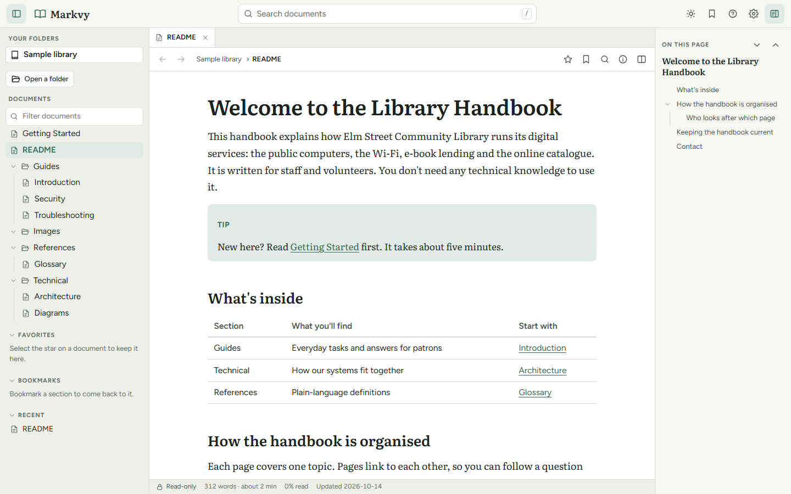
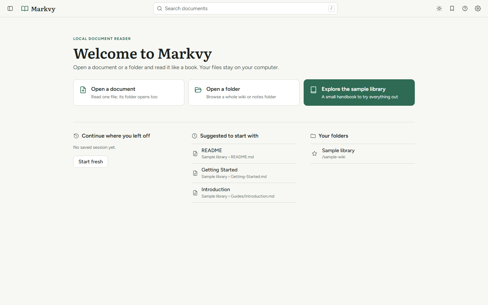
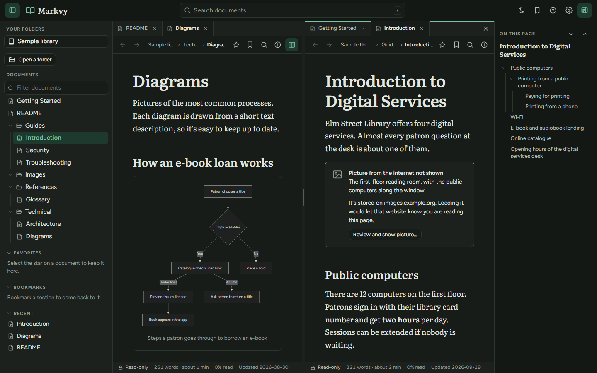
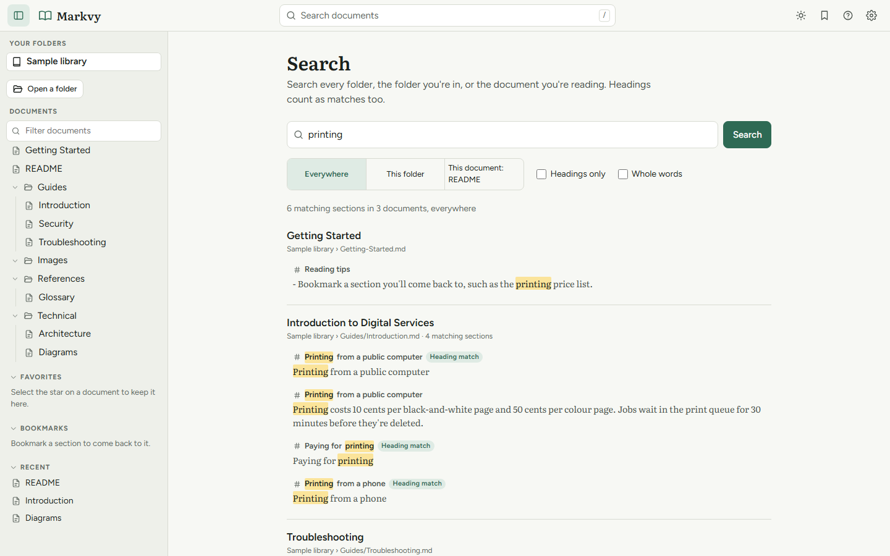
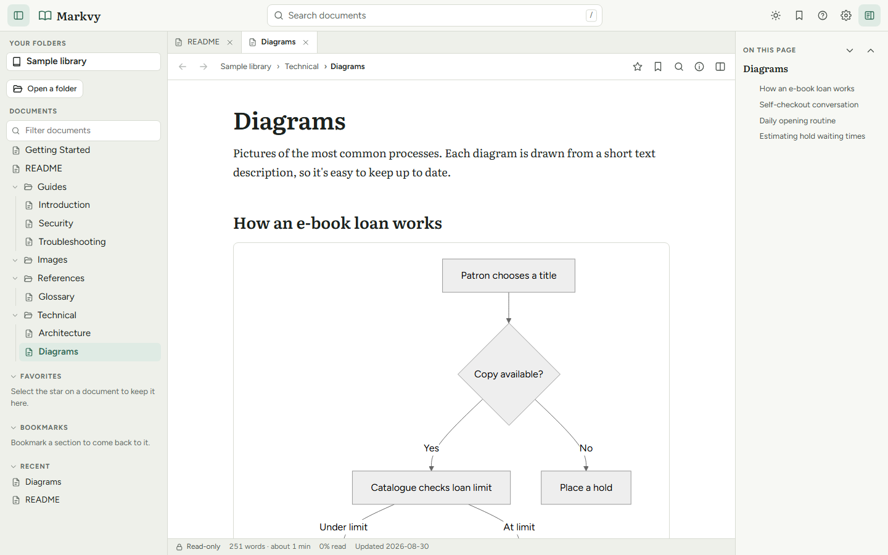
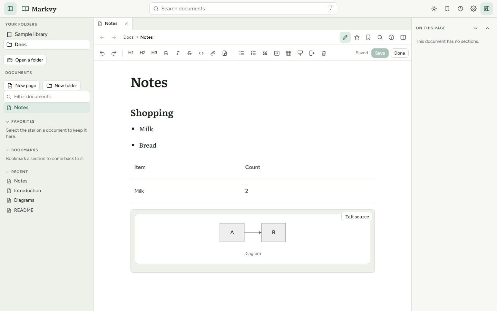

<div align="center">


# Markvy

**Read Markdown like a well-designed book. Edit it like a Word document.**

A calm, private desktop app for Markdown documents and wiki folders, made for people who have never heard of Markdown.


[](LICENSE)

[Download](#download) · [Features](#features) · [Privacy](#privacy) · [Shortcuts](#keyboard-shortcuts) · [Build from source](#build-from-source)

<br>



</div>

---

## Why Markvy?

Teams keep handbooks, requirements and notes as Markdown files in folders and git repositories. Developers are at home there; everyone else gets a wall of `#`, `*` and `|` characters.

Markvy turns those folders into something anyone can read and look after:

- 📖 **It reads like a book.** Clean typography, a contents panel and reading progress, instead of raw text.
- ✏️ **It edits like Word.** A toolbar for headings, lists, tables and pictures. No syntax to learn.
- 🔒 **It stays on your computer.** No accounts, no cloud, no analytics. It works offline.
- 🧭 **It navigates like a documentation site.** Tabs, breadcrumbs, search and links between pages.

---

## Features

### 🏠 Start in seconds

Open a single document, a whole folder, or the built-in sample library to try everything out. Markvy remembers your folders and reopens your tabs the next time you start it.



### 📖 Reading that feels like a book

| | |
|---|---|
| **Comfortable typography** | Literata, Figtree and Lexend fonts, with adjustable text size, line width and line spacing. |
| **Seven colour themes** | Paper, Sepia, Slate, Rose, Night, Dusk and Ember, or Automatic to follow your system. A high-contrast option too. |
| **Contents panel** | Every heading on the page, so you can jump straight to a section. |
| **Tabs and breadcrumbs** | Keep several pages open and always know where you are in the folder. |
| **Reading progress** | Word count, reading time and how far through the page you are. |
| **Favorites and bookmarks** | Star whole documents, or bookmark a single section to come back to. |

### 🪟 Read two pages side by side

Compare a procedure with its reference page, or a draft with the final version. Shown here in the **Night** theme.



### 🔎 Search the whole library

Search every folder, only the current folder, or just the page you're reading. Matches are grouped by document and section, and headings count as matches too.



### 📊 Diagrams, formulas and rich pages

Markvy shows what plain Markdown viewers leave as code:

- **Diagrams** written in [Mermaid](https://mermaid.js.org/), such as flowcharts and sequence diagrams.
- **Formulas** written in LaTeX, drawn with [KaTeX](https://katex.org/).
- **Tables, callouts** (note, tip, important, warning, caution) and **wiki-style links** between pages.
- **Broken links are marked**, with a plain explanation of what's wrong.



### ✏️ Edit like a Word document

Select **Edit this page** and the page becomes editable in place, with a familiar toolbar.

- Headings, bold, italic, lists, quotes, links, tables and code, all from the toolbar.
- **Paste a screenshot** straight into a page. Markvy saves it in an `images` folder next to the page.
- **Save** with <kbd>Ctrl</kbd> + <kbd>S</kbd>. Markvy rewrites only the parts of the file you changed and leaves every other line exactly as it was, so changes in git stay small and easy to review.
- **Unsaved changes are kept as a private draft**, so a crash or a closed window doesn't lose your work.
- **Create, rename and delete** pages and folders. Renaming a page updates the links that point to it. Deleted pages go to the Recycle Bin.
- Prefer read-only? Switch off **Allow editing** in Preferences.



---

## Privacy

Markvy is local-first. These protections are built into the app, not just promised:

| | |
|---|---|
| 🖥️ **Your files stay put** | Markvy reads only files inside the folders you open, and changes them only when you press Save, rename or delete. |
| 📵 **No tracking** | No accounts, no analytics, no crash reporting, no update checks. |
| ✈️ **Works offline** | Nothing needs the internet. |
| 🖼️ **You decide about internet pictures** | A picture stored on a website is shown only after you allow it, and Markvy tells you which site it comes from. |
| 🧹 **Documents are cleaned before display** | A strict content security policy applies, and diagrams and formulas run in their libraries' restricted modes. |

> **Limitation.** The questions before opening a website or showing an internet picture are asked by the part of Markvy that displays pages. If a flaw ever let a document get past the cleaning and the content security policy, it could make Markvy contact a website without asking. No independent security review of these protections has been done yet.

Read the full [privacy statement](docs/release/privacy-policy.md).

---

## Download

Markvy **0.1.0** for Windows (64-bit):

| File | Use it for |
|---|---|
| [`Markvy_0.1.0_x64-setup.exe`](release/0.1.0/Markvy_0.1.0_x64-setup.exe) | The usual installer. Double-click it and follow the steps. |
| [`Markvy_0.1.0_x64_en-US.msi`](release/0.1.0/Markvy_0.1.0_x64_en-US.msi) | Windows Installer package, for IT-managed PCs. |
| [`SHA256SUMS.txt`](release/0.1.0/SHA256SUMS.txt) | Checksums, to confirm the download is intact. |

> [!NOTE]
> These installers are **not yet code-signed**, so Windows SmartScreen may say "Windows protected your PC". Choose **More info › Run anyway** only if the file's checksum matches `SHA256SUMS.txt`:
>
> ```powershell
> Get-FileHash .\Markvy_0.1.0_x64-setup.exe -Algorithm SHA256
> ```

A **Microsoft Store** listing is in preparation. macOS and Linux builds come from the release workflow in this repository.

**Requirements:** Windows 10 or 11 (64-bit) with the Microsoft Edge WebView2 Runtime, which is part of Windows 11. About 300 MB of memory while running.

---

## Keyboard shortcuts

| Shortcut | Action |
|---|---|
| <kbd>/</kbd> or <kbd>Ctrl</kbd> + <kbd>K</kbd> | Search |
| <kbd>Alt</kbd> + <kbd>←</kbd> / <kbd>→</kbd> | Back and forward in the current tab |
| <kbd>[</kbd> and <kbd>]</kbd> | Show or hide the library panel and the contents panel |
| <kbd>\\</kbd> | Read side by side, or go back to one page |
| <kbd>Ctrl</kbd> + click a link | Open the page in a new tab |
| <kbd>Shift</kbd> + click a link | Open the page beside the current one |
| <kbd>←</kbd> / <kbd>→</kbd> on a tab | Move between open tabs |
| <kbd>Ctrl</kbd> + <kbd>S</kbd> | Save the page you're editing |
| <kbd>Esc</kbd> | Close a dialog, menu or search highlights |

---

## Build from source

**You need:** [Node.js](https://nodejs.org/) 20 or later, [Rust](https://rustup.rs/) (stable), and the [Tauri 2 prerequisites](https://v2.tauri.app/start/prerequisites/) for your platform.

```bash
git clone https://github.com/SainathR/Markvy.git
cd Markvy/app
npm ci
npm run tauri dev      # run Markvy with live reload
npm run tauri build    # build the installers
```

**Run the checks** (from `app/`):

```bash
npm test                         # screen and editor tests (Vitest)
npm run check                    # type check
cd src-tauri && cargo test       # Rust core tests
```

The whole-app tests (`npm run test:e2e`) also need `tauri-driver`; see [the release checklist](docs/release/release-checklist.md#7-checks-that-run-automatically-for-reference).

### How it's built

| Layer | Technology |
|---|---|
| App shell | [Tauri 2](https://v2.tauri.app/) with a Rust core. The system web view (WebView2, WebKit or WebKitGTK) draws the screens. |
| Screens | [Svelte 5](https://svelte.dev/) and TypeScript, built with Vite |
| Reading | [marked](https://marked.js.org/), [DOMPurify](https://github.com/cure53/DOMPurify), [Mermaid](https://mermaid.js.org/), [KaTeX](https://katex.org/) |
| Editing | [Milkdown](https://milkdown.dev/) (ProseMirror), saving only the changed blocks |
| File access | Only through the Rust core. The screens have no file-system permission of their own. |

### Project layout

```text
app/
├── src/            Screens (Svelte and TypeScript)
├── src-tauri/      Rust core: files, search, editing, safety checks
├── tests/          Unit tests and the bundled sample library
├── e2e/            Whole-app tests
└── webtest/        Screen tests in a plain browser
docs/
├── images/         Screenshots used in this README
├── release/        Release checklist, Microsoft Store guide, privacy statement
└── superpowers/    Design specs and implementation plans
release/            Built installers
```

---

## Known limitations

- **Very large pages are slow to edit.** Opening a page of about 1 MB for editing takes 10 to 15 seconds. Typical pages open in under a tenth of a second, and reading is unaffected.
- **The installers are not yet code-signed.**
- The interface is in **English** only.

---

<div align="center">

Made by **Sainath Racherla**

<sub>Markvy is a personal project, released under the <a href="LICENSE">MIT License</a>. Questions, ideas or bugs? <a href="https://github.com/SainathR/Markvy/issues">Open an issue</a>.</sub>

</div>
