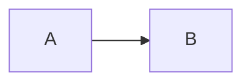

# Mixed *content* and __strong__

> [!NOTE]
> A callout.

$$
E = mc^2
$$

Inline $x^2$ and [[Wiki Page|label]] and [[Other#Part]].

raw html

Text with a footnote[^1].

[^1]: The note.

~~~js
const tilde = true;
~~~
