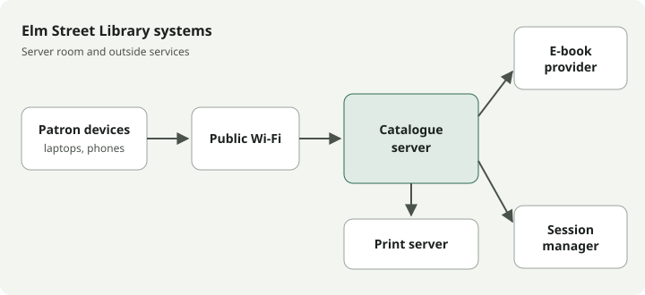

# System Architecture

This page describes the systems behind our digital services and how they connect. It's useful background when a problem affects more than one service.



## Components

| Component | What it does | Where it runs |
|---|---|---|
| Catalogue server | Records every item, loan and hold | Library server room |
| E-book provider | Supplies e-book and audiobook licences | Provider's data centre |
| Session manager | Signs patrons in and resets public computers | Library server room |
| Print server | Holds print jobs until they're paid | Library server room |

## How the parts connect

Patron devices reach the catalogue through the public Wi-Fi. The catalogue checks loan limits before it asks the e-book provider for a licence. See [[Diagrams]] for step-by-step pictures.

### Catalogue server

The catalogue server answers about 40,000 requests on a busy day. It is backed up every night at 02:00.

### Session manager

The session manager reads its settings from the reset file described in [Security](../Guides/Security.md#public-computer-reset).

## Example catalogue record

Each item in the catalogue is stored as a record like this:

```json
{
  "id": "b2049381",
  "title": "The Secret Garden",
  "format": "e-book",
  "copies": 3,
  "on_loan": 3,
  "holds": 5
}
```

## Planning storage

We estimate the backup storage needed for loan history with this formula:

$$
S = n \times \bar{r} \times d
$$

where $n$ is the number of active patrons, $\bar{r}$ is the average record size and $d$ is the number of days we keep backups. With $n = 8200$, $\bar{r} = 2\,\text{KB}$ and $d = 30$, we need about 492 MB.

Terms used on this page are defined in the [Glossary](../References/Glossary.md).
