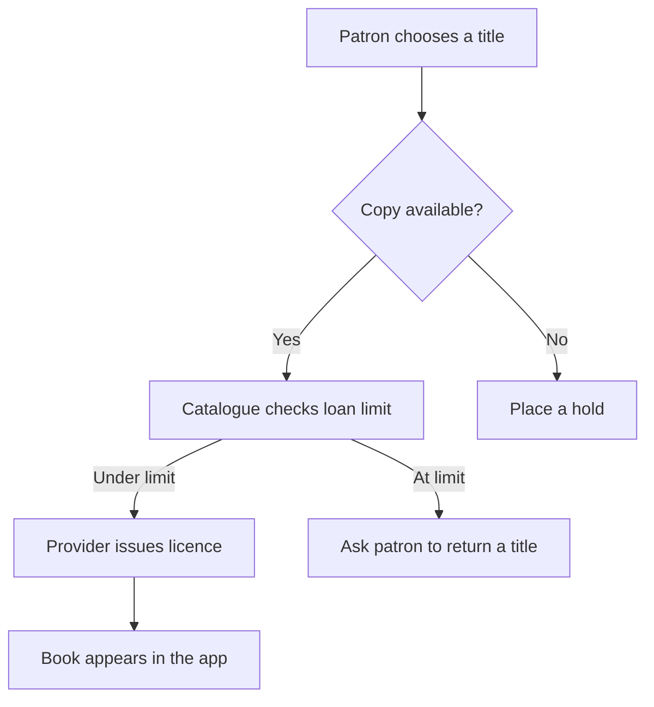
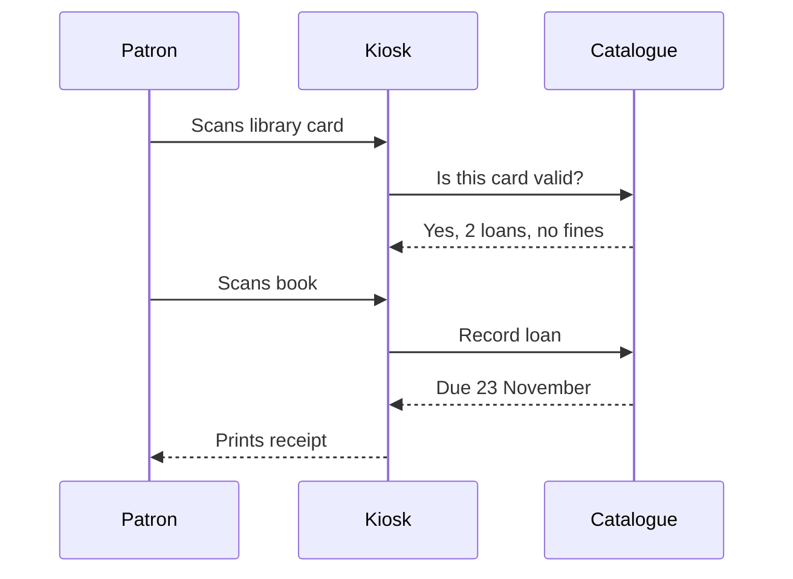
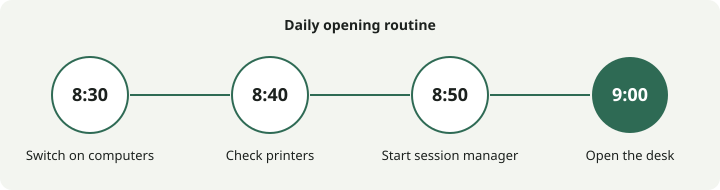

# Diagrams

Pictures of the most common processes. Each diagram is drawn from a short text description, so it's easy to keep up to date.

## How an e-book loan works

## Self-checkout conversation

## Daily opening routine

## Estimating hold waiting times

When all copies are on loan, the expected wait for a hold is roughly

$$
W \approx \frac{q}{c} \times L
$$

where $q$ is the patron's place in the queue, $c$ is the number of copies and $L$ is the loan period in days. Fifth in line for a title with 3 copies and a 21-day loan means waiting about 35 days.
