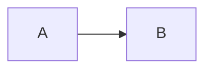

# Markvy Plan 6: Editing Implementation Plan

> **For agentic workers:** REQUIRED SUB-SKILL: Use superpowers:subagent-driven-development (recommended) or superpowers:executing-plans to implement this plan task-by-task. Steps use checkbox (`- [ ]`) syntax for tracking.

**Goal:** Let people edit Markdown documents in Markvy like a Word document, create, rename and delete pages, and never get a noisy git diff or lose work.

**Architecture:** A Rust module `edit.rs` is the only new writer: atomic saves with a fingerprint check, private drafts, page and folder actions, pictures. The screens split each document into blocks with `marked`, edit it in Milkdown (ProseMirror), and on save write untouched blocks back verbatim (identified by ProseMirror node identity) and serialize only edited ones in the file's own style. Link updates for renames are planned in the screens with the reader's own link rules, and applied by Rust all-or-nothing.

**Tech Stack:** Tauri 2, Rust (new crates `sha2`, `trash`, Windows-only `windows-sys`), Svelte 5 runes, TypeScript, Milkdown 7 (`@milkdown/kit`), marked 12, Vitest (jsdom), Playwright, WebdriverIO.

**Spec:** `docs/superpowers/specs/2026-11-16-markvy-editing-design.md` (approved 2026-11-16), building on `docs/superpowers/specs/2026-11-02-folio-desktop-architecture-design.md` (A1–A16). Read both.

## Global Constraints

- Only `edit.rs`, `library.rs` and `log.rs` may write files. `check:readonly` and clippy's `disallowed-methods` must still pass with `edit.rs` as the only new allowed file.
- `edit.rs` writes only inside a collection root (through `paths::resolve` or the new `resolve_folder` + `validate_name`), and inside Markvy's data folder for drafts.
- The Sample library (`workspace::SAMPLE_ID`) and unavailable collections always refuse edits.
- Editing commands refuse unless the screens have called `set_editing_allowed(true)`; the default in Rust is false.
- Untouched blocks are written byte for byte as read. A no-op save leaves the file byte-identical, including line endings, byte-order mark and final newline.
- Never delete permanently. Delete goes to the Recycle Bin or refuses with `NoRecycleBin`.
- No new code may use the network; `NETWORK_PATTERNS` in `check-readonly.mjs` stays as is. Every new crate and npm package passes `npm run check:deps -- --update` review (A14).
- Pictures: PNG, JPG, GIF, WebP only, at most 20 MB.
- Draft autosave: about 1 second after typing stops.
- Speed: edit mode under 300 ms for a typical page and under 1 s for 1 MB; save under 200 ms; no keystroke frame over 50 ms on 1 MB.
- User-facing wording, verbatim from the spec: "Markvy changes your files only when you press Save, rename or delete. Unsaved changes are kept in Markvy's own folder on this computer and are never sent anywhere."
- Build environment (Windows): `export PATH="$USERPROFILE/.cargo/bin:$PATH"; export CARGO_TARGET_DIR="$LOCALAPPDATA/folio-target"`.
- Commit trailer: `Co-Authored-By: <your model name> <noreply@anthropic.com>`.

## Decisions this plan makes inside the spec

- **Link planning lives in the screens.** The spec's risk table says links are found "through the index's link parser, which the broken-link check already uses". That parser is `app/src/lib/markdown/links.ts`. So `plan_rename` and `plan_delete` are TypeScript functions (`planRename`, `inboundLinks`), and Rust gets the finished edits with their base fingerprints (`rename_with_edits`). Rust still checks every fingerprint and applies everything all-or-nothing.
- **Own-save suppression lives in the screens.** An edit session keeps its latest saved fingerprint; on a `collection-changed` event for its page it asks Rust for the current fingerprint and ignores the event when they match. No timing window in Rust is needed.
- **File-name suggestion** copies the folder's separator style (hyphen, underscore or space). It does not add a numeric prefix: the spec's own example (`00-Module-Overview.md` suggests `Payment-Rules.md`) shows none.
- **Documents Markvy decoded lossily** (invalid UTF-8) cannot be edited: saving would replace their bytes. Edit is refused with `NotEditable`.
- **Fingerprint** is SHA-256 of the file's bytes, hex-encoded.
- **Pasting text** from Word or the web uses Milkdown's clipboard plugin, which parses HTML through the editor's schema, so scripts, styles and unknown tags are dropped. The spec's separate `paste.ts` is not needed; pictures are handled in `EditorPane.svelte`.
- **Drafts made against an older file** keep that file's fingerprint as their base; saving them always shows both full versions, never an automatic combine.

## Review Focus

1. **A file with mixed line endings (some CRLF, some LF).** A reasonable person expects untouched lines to keep their own endings. Test: Task 5 `keeps mixed line endings of untouched blocks`.
2. **A UTF-16 or BOM file saved after an edit.** Expects the same encoding and BOM back. Test: Task 1 `save_keeps_utf16_and_bom`.
3. **Two quick Ctrl+S presses, or Save while a draft write is in flight.** Expects one save and no conflict with itself. Test: Task 9 `a second save while saving waits for the first`.
4. **Inserting a paragraph between a paragraph and a list that touched it** (`text\n- item`). Expects the new paragraph to stay separate, not merge. Test: Task 7 `inserting between touching blocks keeps them apart`.
5. **Renaming a page that the renamed page links to itself, or a folder containing linking pages.** Expects all links to keep working. Test: Task 8 `rename inside a renamed folder keeps relative links working`.

---

## File Structure

| File | Responsibility |
|---|---|
| `app/src-tauri/src/edit.rs` (new) | Fingerprints, encodings, atomic writes, name rules, save, drafts, create, rename with edits, delete, pictures |
| `app/src-tauri/src/errors.rs` | New codes: `FileInUse`, `DiskFull`, `NotEditable`, `NameRefused(reason)`, `NoRecycleBin`, `Changed` |
| `app/src-tauri/src/reader.rs` | `decode` becomes `pub(crate)` |
| `app/src-tauri/src/state.rs` | `editing: AtomicBool` and `editable_root()` |
| `app/src-tauri/src/commands.rs` | Thin `#[tauri::command]` wrappers for edit commands |
| `app/src-tauri/src/lib.rs` | Registers the commands |
| `app/scripts/check-readonly.mjs` (+ test) | `edit.rs` allowed |
| `app/src/lib/core.ts` | Types, wrappers, codes and messages |
| `app/src/lib/editor/blocks.ts` (new) | Split text into blocks with exact original text |
| `app/src/lib/editor/style.ts` (new) | Detect Markdown style; serializer options |
| `app/src/lib/editor/codec.ts` (new) | Milkdown editor factory, parse/serialize, wiki link, inline maths and card nodes |
| `app/src/lib/editor/model.ts` (new) | Build the editor document from blocks; block-patched save |
| `app/src/lib/editor/merge.ts` (new) | Three-way block merge for conflicts |
| `app/src/lib/editor/names.ts` (new) | Name rules (mirror of Rust) and file-name suggestion |
| `app/src/lib/editor/linkedit.ts` (new) | Rename link edits and inbound links for delete |
| `app/src/state/edit.svelte.ts` (new) | Edit sessions: drafts, save, conflicts, own-save suppression |
| `app/src/EditorPane.svelte` (new) | Editor surface, toolbar, Save, draft dot, card view, paste |
| `app/src/ConflictDialog.svelte`, `FileActionDialog.svelte` (new) | Conflict choices; new/rename/delete dialogs |
| `app/src/TreeView.svelte`, `ReaderPane.svelte`, `DocumentView.svelte`, `PrefsView.svelte`, `HelpView.svelte`, `DetailsDialog.svelte` | Entry points and wording |
| `app/tests/fixtures/editing/` (new) | Round-trip fixtures |

---

### Task 1: `edit.rs` foundation — fingerprints, encodings, atomic save

**Files:**
- Create: `app/src-tauri/src/edit.rs`
- Modify: `app/src-tauri/src/errors.rs`, `app/src-tauri/src/reader.rs:36`, `app/src-tauri/src/lib.rs` (add `pub mod edit;`), `app/src-tauri/Cargo.toml`, `app/scripts/check-readonly.mjs:14`, `app/scripts/check-readonly.test.mjs`, `app/src-tauri/clippy.toml:1`, `app/scripts/reviewed-deps.json`

**Interfaces:**
- Produces (Rust, `crate::edit`):
  - `pub fn fingerprint(bytes: &[u8]) -> String`
  - `pub enum Encoding { Utf8, Utf8Bom, Utf16Le, Utf16Be }`, `pub fn encoding_of(bytes: &[u8]) -> Encoding`, `pub fn encode(text: &str, enc: Encoding) -> Vec<u8>`
  - `pub struct EditSource { pub text: String, pub hash: String }` (serde camelCase)
  - `pub enum Saved { Saved { hash: String }, Conflict { text: String, hash: String } }` (serde `tag = "status"`, lowercase)
  - `pub fn open(path: &Path) -> Result<EditSource, AppError>`
  - `pub fn save(path: &Path, text: &str, base_hash: &str) -> Result<Saved, AppError>`
  - `pub fn write_atomic(target: &Path, bytes: &[u8]) -> Result<(), AppError>`
  - `pub(crate) fn write_err(e: io::Error) -> AppError`
- Produces (errors): `AppError::{FileInUse, DiskFull, NotEditable, NameRefused(String), NoRecycleBin, Changed}`

- [ ] **Step 1: Add the crates**

In `app/src-tauri/Cargo.toml` under `[dependencies]` add:

```toml
sha2 = "0.10"
trash = "5"
```

and under the existing `[target.'cfg(windows)'.dependencies]` add:

```toml
windows-sys = { version = "0.59", features = ["Win32_Storage_FileSystem"] }
```

Run: `cd app && npm run check:deps`
Expected: FAIL naming the new crates. Check each (`sha2`, `trash` and their new dependencies) has no network code, then run `npm run check:deps -- --update` and confirm it passes.

- [ ] **Step 2: Add the error codes with a failing test**

In `errors.rs`, add to `enum AppError` after `LinkRefused`:

```rust
    /// Another program has the file open, so it can't be replaced right now.
    FileInUse,
    DiskFull,
    /// This document can't be edited: the Sample library, editing switched off, or text Markvy can't save back exactly.
    NotEditable,
    /// A file or folder name Markvy won't use. Details: Empty, Invalid, Reserved, Taken, TooLong, WrongType.
    NameRefused(String),
    /// The location has no Recycle Bin, so Markvy won't delete there.
    NoRecycleBin,
    /// A file changed after Markvy planned an action on it.
    Changed,
```

Add to the tests module:

```rust
    #[test]
    fn edit_codes_serialize_as_codes() {
        for (e, code) in [(AppError::FileInUse, "FileInUse"), (AppError::DiskFull, "DiskFull"), (AppError::NotEditable, "NotEditable"), (AppError::NoRecycleBin, "NoRecycleBin"), (AppError::Changed, "Changed")] {
            assert_eq!(serde_json::to_value(e).unwrap(), json!({ "code": code }));
        }
        assert_eq!(serde_json::to_value(AppError::NameRefused("Taken".into())).unwrap(), json!({ "code": "NameRefused", "details": "Taken" }));
    }
```

Run: `cd app/src-tauri && cargo test errors::`
Expected: PASS (the enum compiles with the new variants).

- [ ] **Step 3: Let `edit.rs` write**

In `app/scripts/check-readonly.mjs` change the allow list to:

```js
export const ALLOWED_FILES = new Set(['library.rs', 'src/library.rs', 'log.rs', 'src/log.rs', 'edit.rs', 'src/edit.rs']);
```

and change its first-line comment to `// Fails the build if file-writing code appears outside library.rs, log.rs and edit.rs (spec §6, amendment A16).`

In `app/scripts/check-readonly.test.mjs` add:

```js
  it('lets edit.rs write and nothing new besides', () => {
    expect(findWrites('edit.rs', 'fs::rename(&temp, target)?;')).toEqual([]);
    expect(findWrites('reader.rs', 'fs::rename(&a, b)?;').length).toBe(1);
  });
```

In `app/src-tauri/clippy.toml` change the first-line comment to `# Markvy changes files only through edit.rs (spec A16); library.rs and log.rs write its own data. They opt out with #![allow(clippy::disallowed_methods)].`

In `reader.rs` change `fn decode(` to `pub(crate) fn decode(`.

Run: `cd app && npx vitest run scripts/check-readonly.test.mjs`
Expected: PASS.

- [ ] **Step 4: Write the failing tests for `edit.rs`**

Create `app/src-tauri/src/edit.rs` with only the test module first (add `pub mod edit;` to `lib.rs` after `pub mod errors;`):

```rust
#[cfg(test)]
mod tests {
    use super::*;
    use std::fs;

    #[test]
    fn fingerprint_is_sha256_hex() {
        assert_eq!(fingerprint(b"abc"), "ba7816bf8f01cfea414140de5dae2223b00361a396177a9cb410ff61f20015ad");
    }

    #[test]
    fn encodings_round_trip() {
        for enc in [Encoding::Utf8, Encoding::Utf8Bom, Encoding::Utf16Le, Encoding::Utf16Be] {
            let bytes = encode("héllo\r\n", enc);
            assert_eq!(encoding_of(&bytes), enc);
            assert_eq!(crate::reader::decode(&bytes).unwrap().0, "héllo\r\n");
        }
    }

    #[test]
    fn open_returns_text_and_fingerprint_and_refuses_lossy_text() {
        let d = tempfile::tempdir().unwrap();
        let p = d.path().join("a.md");
        fs::write(&p, "# A\n").unwrap();
        let s = open(&p).unwrap();
        assert_eq!((s.text.as_str(), s.hash), ("# A\n", fingerprint(b"# A\n")));
        fs::write(&p, b"bad \xFF byte").unwrap();
        assert!(matches!(open(&p), Err(AppError::NotEditable)));
    }

    #[test]
    fn save_writes_when_unchanged_and_reports_a_conflict_otherwise() {
        let d = tempfile::tempdir().unwrap();
        let p = d.path().join("a.md");
        fs::write(&p, "one\n").unwrap();
        let base = fingerprint(b"one\n");
        let Saved::Saved { hash } = save(&p, "two\n", &base).unwrap() else { panic!("expected saved") };
        assert_eq!(fs::read_to_string(&p).unwrap(), "two\n");
        assert_eq!(hash, fingerprint(b"two\n"));
        match save(&p, "three\n", &base).unwrap() {
            Saved::Conflict { text, hash } => assert_eq!((text.as_str(), hash), ("two\n", fingerprint(b"two\n"))),
            Saved::Saved { .. } => panic!("expected a conflict"),
        }
        assert_eq!(fs::read_to_string(&p).unwrap(), "two\n");
    }

    #[test]
    fn save_keeps_utf16_and_bom() {
        let d = tempfile::tempdir().unwrap();
        let p = d.path().join("a.md");
        for enc in [Encoding::Utf8Bom, Encoding::Utf16Le, Encoding::Utf16Be] {
            let before = encode("old\r\n", enc);
            fs::write(&p, &before).unwrap();
            save(&p, "new\r\n", &fingerprint(&before)).unwrap();
            assert_eq!(fs::read(&p).unwrap(), encode("new\r\n", enc));
        }
    }

    #[test]
    fn atomic_write_leaves_no_temporary_file_and_cleans_old_ones() {
        let d = tempfile::tempdir().unwrap();
        let old = d.path().join(".~markvy-stale.tmp");
        fs::write(&old, "x").unwrap();
        let t = std::time::SystemTime::now() - std::time::Duration::from_secs(3600);
        fs::File::options().write(true).open(&old).unwrap().set_modified(t).unwrap();
        write_atomic(&d.path().join("a.md"), b"hi").unwrap();
        let names: Vec<String> = fs::read_dir(d.path()).unwrap().map(|e| e.unwrap().file_name().to_string_lossy().into_owned()).collect();
        assert_eq!(names, vec!["a.md".to_string()]);
    }

    #[test]
    fn write_errors_map_to_codes() {
        assert_eq!(write_err(io::Error::from_raw_os_error(if cfg!(windows) { 32 } else { 26 })), AppError::FileInUse);
        assert_eq!(write_err(io::Error::from_raw_os_error(if cfg!(windows) { 112 } else { 28 })), AppError::DiskFull);
        assert_eq!(write_err(io::Error::from(io::ErrorKind::PermissionDenied)), AppError::AccessDenied);
    }
}
```

Run: `cd app/src-tauri && cargo test edit::`
Expected: FAIL to compile (`fingerprint` and the rest are not defined).

- [ ] **Step 5: Implement the foundation**

Put this above the test module in `edit.rs`:

```rust
#![allow(clippy::disallowed_methods)] // the one module that changes documents (spec amendment A16)
//! Every change Markvy makes to a person's files goes through here: atomic, fingerprint-checked, inside a collection.
use crate::{errors::AppError, reader};
use serde::{Deserialize, Serialize};
use sha2::{Digest, Sha256};
use std::{
    fs, io::{self, Write},
    path::{Path, PathBuf},
    time::{Duration, SystemTime},
};

pub fn fingerprint(bytes: &[u8]) -> String {
    Sha256::digest(bytes).iter().map(|b| format!("{b:02x}")).collect()
}

#[derive(Debug, Clone, Copy, PartialEq, Eq, Serialize, Deserialize)]
pub enum Encoding { Utf8, Utf8Bom, Utf16Le, Utf16Be }

pub fn encoding_of(bytes: &[u8]) -> Encoding {
    if bytes.starts_with(&[0xEF, 0xBB, 0xBF]) { Encoding::Utf8Bom }
    else if bytes.starts_with(&[0xFF, 0xFE]) { Encoding::Utf16Le }
    else if bytes.starts_with(&[0xFE, 0xFF]) { Encoding::Utf16Be }
    else { Encoding::Utf8 }
}

pub fn encode(text: &str, enc: Encoding) -> Vec<u8> {
    match enc {
        Encoding::Utf8 => text.as_bytes().to_vec(),
        Encoding::Utf8Bom => [&[0xEF, 0xBB, 0xBF][..], text.as_bytes()].concat(),
        Encoding::Utf16Le => [0xFF, 0xFE].into_iter().chain(text.encode_utf16().flat_map(u16::to_le_bytes)).collect(),
        Encoding::Utf16Be => [0xFE, 0xFF].into_iter().chain(text.encode_utf16().flat_map(u16::to_be_bytes)).collect(),
    }
}

#[derive(Debug, Serialize)]
#[serde(rename_all = "camelCase")]
pub struct EditSource { pub text: String, pub hash: String }

#[derive(Debug, Serialize)]
#[serde(tag = "status", rename_all = "lowercase")]
pub enum Saved { Saved { hash: String }, Conflict { text: String, hash: String } }

fn read_capped(path: &Path) -> Result<Vec<u8>, AppError> {
    let meta = fs::metadata(path)?;
    if meta.is_dir() { return Err(AppError::NotText); }
    if meta.len() > reader::MAX_BYTES { return Err(AppError::TooLarge); }
    Ok(fs::read(path)?)
}

/// The text to edit and the fingerprint the save must still match. Text Markvy can't write back exactly is refused.
pub fn open(path: &Path) -> Result<EditSource, AppError> {
    let bytes = read_capped(path)?;
    let (text, lossy) = reader::decode(&bytes)?;
    if lossy { return Err(AppError::NotEditable); }
    Ok(EditSource { text, hash: fingerprint(&bytes) })
}

/// Writes `text` if the file is still the one the editor started from; otherwise returns what is on disk now.
/// The file keeps its encoding and byte-order mark.
pub fn save(path: &Path, text: &str, base_hash: &str) -> Result<Saved, AppError> {
    let current = read_capped(path)?;
    let now = fingerprint(&current);
    if now != base_hash {
        let (text, _) = reader::decode(&current)?;
        return Ok(Saved::Conflict { text, hash: now });
    }
    let bytes = encode(text, encoding_of(&current));
    write_atomic(path, &bytes)?;
    Ok(Saved::Saved { hash: fingerprint(&bytes) })
}

pub(crate) fn write_err(e: io::Error) -> AppError {
    match e.raw_os_error() {
        Some(32 | 33) if cfg!(windows) => return AppError::FileInUse,   // sharing / lock violation
        Some(26) if !cfg!(windows) => return AppError::FileInUse,       // ETXTBSY
        Some(39 | 112) if cfg!(windows) => return AppError::DiskFull,
        Some(28) if !cfg!(windows) => return AppError::DiskFull,        // ENOSPC
        _ => {}
    }
    AppError::from_io(e)
}

const TEMP_PREFIX: &str = ".~markvy-";

fn temp_name() -> String {
    let nanos = SystemTime::now().duration_since(SystemTime::UNIX_EPOCH).map(|d| d.as_nanos()).unwrap_or(0);
    format!("{TEMP_PREFIX}{}-{nanos}.tmp", std::process::id())
}

/// Temporary files left by a crash, older than ten minutes so a save in progress elsewhere is never touched.
fn clean_stale_temps(dir: &Path) {
    let Ok(entries) = fs::read_dir(dir) else { return };
    for e in entries.flatten() {
        let name = e.file_name().to_string_lossy().into_owned();
        let old = e.metadata().and_then(|m| m.modified()).ok()
            .and_then(|t| t.elapsed().ok()).is_some_and(|age| age > Duration::from_secs(600));
        if name.starts_with(TEMP_PREFIX) && name.ends_with(".tmp") && old {
            let _ = fs::remove_file(e.path());
        }
    }
}

/// Write a hidden temporary file next to the target, flush it, then rename it over the target.
/// A program holding the file open is retried for up to 2 seconds.
pub fn write_atomic(target: &Path, bytes: &[u8]) -> Result<(), AppError> {
    let dir = target.parent().ok_or(AppError::NotFound)?;
    clean_stale_temps(dir);
    let temp = dir.join(temp_name());
    let written = (|| -> io::Result<()> {
        let mut f = fs::OpenOptions::new().write(true).create_new(true).open(&temp)?;
        f.write_all(bytes)?;
        f.sync_all()?;
        #[cfg(unix)]
        if let Ok(meta) = fs::metadata(target) { fs::set_permissions(&temp, meta.permissions())?; }
        Ok(())
    })();
    if let Err(e) = written {
        let _ = fs::remove_file(&temp);
        return Err(write_err(e));
    }
    let mut tries = 0;
    loop {
        match fs::rename(&temp, target) {
            Ok(()) => return Ok(()),
            Err(e) => {
                // Windows refuses to replace a file another program holds open (access denied or sharing violation).
                let busy = cfg!(windows) && matches!(e.raw_os_error(), Some(5 | 32 | 33));
                if busy && tries < 20 {
                    tries += 1;
                    std::thread::sleep(Duration::from_millis(100));
                    continue;
                }
                let _ = fs::remove_file(&temp);
                return Err(if busy { AppError::FileInUse } else { write_err(e) });
            }
        }
    }
}
```

At the top of `write_atomic`, before writing the temporary file, refuse a read-only target so it is reported as no permission rather than "in use":

```rust
    if fs::metadata(target).is_ok_and(|m| m.permissions().readonly()) { return Err(AppError::AccessDenied); }
```

In this task the `use std::path::{Path, PathBuf}` import only needs `Path`; Task 2 adds the use of `PathBuf`.

Run: `cd app/src-tauri && cargo test edit:: && cargo test errors::`
Expected: PASS.

- [ ] **Step 6: Lint the write boundary as CI does**

Run: `cd app && npm run check:readonly && cargo clippy --manifest-path src-tauri/Cargo.toml -- -A clippy::all -D clippy::disallowed_methods`
Expected: both pass.

- [ ] **Step 7: Commit**

```bash
git add app/src-tauri app/scripts
git commit -m "feat(edit): atomic, fingerprint-checked saves in edit.rs, the one new writer"
```

---

### Task 2: Collection rules, drafts and the edit commands

**Files:**
- Modify: `app/src-tauri/src/edit.rs`, `app/src-tauri/src/state.rs`, `app/src-tauri/src/commands.rs`, `app/src-tauri/src/lib.rs:31-38`

**Interfaces:**
- Consumes: Task 1 `open`, `save`, `write_atomic`, `fingerprint`.
- Produces (Rust):
  - `AppState.editing: AtomicBool` (false at start); `AppState::editable_root(&self, id: &str) -> Result<PathBuf, AppError>`
  - `pub struct Draft { pub collection_id: String, pub path: String, pub base_hash: String, pub text: String, pub saved_at: u64 }` (serde camelCase, Deserialize too)
  - `pub fn save_draft(data_dir: &Path, d: &Draft) -> Result<(), AppError>`, `pub fn take_draft(data_dir: &Path, cid: &str, path: &str) -> Result<Option<Draft>, AppError>`, `pub fn discard_draft(data_dir: &Path, cid: &str, path: &str) -> Result<(), AppError>`, `pub fn list_drafts(data_dir: &Path) -> Vec<Draft>`
- Produces (commands, camelCase args from the screens): `set_editing_allowed(allowed)`, `open_for_edit(collectionId, path) -> EditSource`, `file_fingerprint(collectionId, path) -> String`, `save_document(collectionId, path, text, baseHash) -> Saved`, `save_draft(draft)`, `take_draft(collectionId, path) -> Option<Draft>`, `discard_draft(collectionId, path)`, `list_drafts() -> Vec<Draft>`.

- [ ] **Step 1: Failing tests**

Add to `state.rs` tests:

```rust
    #[test]
    fn editing_needs_permission_a_real_folder_and_not_the_sample() {
        let d = tempfile::tempdir().unwrap();
        let col = crate::workspace::Collection::new(d.path().to_path_buf());
        let sample = crate::workspace::Collection { id: crate::workspace::SAMPLE_ID.into(), name: "S".into(), root: d.path().into(), available: true };
        let s = AppState::new(d.path().to_path_buf(), vec![col.clone(), sample], Ok(LoadResult::fresh()));
        assert_eq!(s.editable_root(&col.id), Err(AppError::NotEditable));
        s.editing.store(true, Ordering::Relaxed);
        assert!(s.editable_root(&col.id).is_ok());
        assert_eq!(s.editable_root(crate::workspace::SAMPLE_ID), Err(AppError::NotEditable));
        assert_eq!(s.editable_root("nope"), Err(AppError::CollectionUnavailable));
    }
```

(If `state.rs` tests lack the imports, add `use crate::library::LoadResult; use crate::errors::AppError; use std::sync::atomic::Ordering;` inside the module.)

Add to `edit.rs` tests:

```rust
    #[test]
    fn drafts_save_list_take_and_discard() {
        let d = tempfile::tempdir().unwrap();
        let draft = Draft { collection_id: "c1".into(), path: "Guides/A.md".into(), base_hash: "h".into(), text: "t".into(), saved_at: 5 };
        save_draft(d.path(), &draft).unwrap();
        assert_eq!(list_drafts(d.path()).len(), 1);
        assert_eq!(take_draft(d.path(), "c1", "Guides/A.md").unwrap().unwrap().text, "t");
        assert!(take_draft(d.path(), "c1", "Other.md").unwrap().is_none());
        discard_draft(d.path(), "c1", "Guides/A.md").unwrap();
        discard_draft(d.path(), "c1", "Guides/A.md").unwrap(); // a second discard is fine
        assert!(list_drafts(d.path()).is_empty());
    }

    #[test]
    fn a_damaged_draft_is_skipped_not_fatal() {
        let d = tempfile::tempdir().unwrap();
        fs::create_dir_all(d.path().join("drafts/c1")).unwrap();
        fs::write(d.path().join("drafts/c1/x.json"), "{broken").unwrap();
        assert!(list_drafts(d.path()).is_empty());
    }
```

Run: `cd app/src-tauri && cargo test edit:: state::`
Expected: FAIL to compile.

- [ ] **Step 2: Implement state rules**

In `state.rs` add the field `pub editing: AtomicBool,` (doc comment: `/// Set by the screens from the Allow editing preference; false until they say otherwise (spec §6).`), initialise `editing: AtomicBool::new(false),` in `new`, and add:

```rust
    /// The root of a collection that may be edited now, or why not.
    pub fn editable_root(&self, id: &str) -> Result<PathBuf, AppError> {
        let root = self.root_of(id)?;
        if !self.editing.load(Ordering::Relaxed) || id == crate::workspace::SAMPLE_ID {
            return Err(AppError::NotEditable);
        }
        if !root.is_dir() {
            return Err(AppError::CollectionUnavailable);
        }
        Ok(root)
    }
```

- [ ] **Step 3: Implement drafts**

In `edit.rs`:

```rust
#[derive(Debug, Clone, Serialize, Deserialize, PartialEq)]
#[serde(rename_all = "camelCase")]
pub struct Draft { pub collection_id: String, pub path: String, pub base_hash: String, pub text: String, pub saved_at: u64 }

fn draft_file(data_dir: &Path, cid: &str, path: &str) -> PathBuf {
    data_dir.join("drafts").join(cid).join(format!("{}.json", fingerprint(path.as_bytes())))
}

pub fn save_draft(data_dir: &Path, d: &Draft) -> Result<(), AppError> {
    let file = draft_file(data_dir, &d.collection_id, &d.path);
    fs::create_dir_all(file.parent().expect("draft file has a folder")).map_err(write_err)?;
    let bytes = serde_json::to_vec(d).map_err(|e| AppError::Internal(e.to_string()))?;
    write_atomic(&file, &bytes)
}

pub fn take_draft(data_dir: &Path, cid: &str, path: &str) -> Result<Option<Draft>, AppError> {
    match fs::read(draft_file(data_dir, cid, path)) {
        Ok(b) => Ok(serde_json::from_slice(&b).ok()),
        Err(e) if e.kind() == io::ErrorKind::NotFound => Ok(None),
        Err(e) => Err(AppError::from_io(e)),
    }
}

pub fn discard_draft(data_dir: &Path, cid: &str, path: &str) -> Result<(), AppError> {
    match fs::remove_file(draft_file(data_dir, cid, path)) {
        Err(e) if e.kind() != io::ErrorKind::NotFound => Err(AppError::from_io(e)),
        _ => Ok(()),
    }
}

/// Every readable draft; a damaged one is skipped so it can't block the rest.
pub fn list_drafts(data_dir: &Path) -> Vec<Draft> {
    let Ok(cols) = fs::read_dir(data_dir.join("drafts")) else { return vec![] };
    cols.flatten()
        .filter_map(|c| fs::read_dir(c.path()).ok())
        .flat_map(|files| files.flatten())
        .filter_map(|f| fs::read(f.path()).ok())
        .filter_map(|b| serde_json::from_slice::<Draft>(&b).ok())
        .collect()
}
```

- [ ] **Step 4: Commands**

Append to `commands.rs` (above the tests module; add `use crate::edit;` to the imports and `use std::sync::atomic::Ordering;`):

```rust
#[tauri::command(async)]
pub fn set_editing_allowed(state: State<'_, AppState>, allowed: bool) -> Result<(), AppError> {
    guarded(&state, "set_editing_allowed", || { state.editing.store(allowed, Ordering::Relaxed); Ok(()) })
}

#[tauri::command(async)]
pub fn open_for_edit(state: State<'_, AppState>, collection_id: String, path: String) -> Result<edit::EditSource, AppError> {
    guarded(&state, "open_for_edit", || {
        let root = state.editable_root(&collection_id)?;
        let file = paths::resolve(&root, &path)?;
        if workspace::kind_of(&path) != Some(workspace::NodeKind::Document) { return Err(AppError::NotEditable); }
        edit::open(&file)
    })
}

#[tauri::command(async)]
pub fn file_fingerprint(state: State<'_, AppState>, collection_id: String, path: String) -> Result<String, AppError> {
    guarded(&state, "file_fingerprint", || {
        let root = state.root_of(&collection_id)?;
        Ok(edit::fingerprint(&std::fs::read(paths::resolve(&root, &path)?)?))
    })
}

#[tauri::command(async)]
pub fn save_document(state: State<'_, AppState>, collection_id: String, path: String, text: String, base_hash: String) -> Result<edit::Saved, AppError> {
    guarded(&state, "save_document", || {
        let root = state.editable_root(&collection_id)?;
        let saved = edit::save(&paths::resolve(&root, &path)?, &text, &base_hash)?;
        if matches!(saved, edit::Saved::Saved { .. }) {
            edit::discard_draft(&state.data_dir, &collection_id, &path)?;
            let _ = log::append(&state.data_dir, &format!("saved {collection_id}/{path}"));
        }
        Ok(saved)
    })
}

#[tauri::command(async)]
pub fn save_draft(state: State<'_, AppState>, draft: edit::Draft) -> Result<(), AppError> {
    guarded(&state, "save_draft", || {
        state.editable_root(&draft.collection_id)?;
        edit::save_draft(&state.data_dir, &draft)
    })
}

#[tauri::command(async)]
pub fn take_draft(state: State<'_, AppState>, collection_id: String, path: String) -> Result<Option<edit::Draft>, AppError> {
    guarded(&state, "take_draft", || edit::take_draft(&state.data_dir, &collection_id, &path))
}

#[tauri::command(async)]
pub fn discard_draft(state: State<'_, AppState>, collection_id: String, path: String) -> Result<(), AppError> {
    guarded(&state, "discard_draft", || edit::discard_draft(&state.data_dir, &collection_id, &path))
}

#[tauri::command(async)]
pub fn list_drafts(state: State<'_, AppState>) -> Result<Vec<edit::Draft>, AppError> {
    guarded(&state, "list_drafts", || Ok(edit::list_drafts(&state.data_dir)))
}
```

`workspace::NodeKind` must derive `PartialEq` for the comparison; add it if missing. `log::append` is the existing helper; it never logs file contents.

Register in `lib.rs` inside `markvy_handler!` after `commands::take_recovery,`:

```rust
            commands::set_editing_allowed, commands::open_for_edit, commands::file_fingerprint, commands::save_document,
            commands::save_draft, commands::take_draft, commands::discard_draft, commands::list_drafts,
```

- [ ] **Step 5: Run**

Run: `cd app/src-tauri && cargo test && cd .. && npm run check:readonly && cargo clippy --manifest-path src-tauri/Cargo.toml -- -A clippy::all -D clippy::disallowed_methods`
Expected: all pass.

- [ ] **Step 6: Commit**

```bash
git add app/src-tauri
git commit -m "feat(edit): drafts, editing permission and the save commands"
```

---

### Task 3: Names, new pages and folders, rename with link edits, delete, pictures

**Files:**
- Modify: `app/src-tauri/src/edit.rs`, `app/src-tauri/src/commands.rs`, `app/src-tauri/src/lib.rs`

**Interfaces:**
- Consumes: Task 1–2.
- Produces (Rust):
  - `pub fn validate_name(name: &str) -> Result<(), AppError>` (reasons `Empty`, `Invalid`, `Reserved`, `TooLong`)
  - `pub fn resolve_folder(root: &Path, folder: &str) -> Result<PathBuf, AppError>` ("" is the root)
  - `pub fn create_page(root: &Path, folder: &str, name: &str, title: &str) -> Result<String, AppError>` returns the new relative path
  - `pub fn create_folder(root: &Path, parent: &str, name: &str) -> Result<String, AppError>`
  - `#[derive(Deserialize)] pub struct FileEdit { pub path: String, pub text: String, pub base_hash: String }` (camelCase)
  - `pub fn rename_with_edits(root: &Path, from: &str, new_name: &str, edits: &[FileEdit]) -> Result<String, AppError>` returns the new relative path
  - `pub fn delete(root: &Path, rel: &str) -> Result<(), AppError>`
  - `pub fn save_picture(root: &Path, page: &str, bytes: &[u8]) -> Result<String, AppError>` returns the picture's path relative to the page's folder (`images/<file>`)
- Produces (commands): `create_page(collectionId, folder, name, title) -> String`, `create_folder(collectionId, parent, name) -> String`, `rename_with_edits(collectionId, from, newName, edits) -> String`, `delete_entry(collectionId, path)`, `save_picture(collectionId, page, base64) -> String`.

- [ ] **Step 1: Failing tests** (add to `edit.rs` tests)

```rust
    fn reason(r: Result<impl std::fmt::Debug, AppError>) -> String {
        match r { Err(AppError::NameRefused(why)) => why, other => format!("{other:?}") }
    }

    #[test]
    fn names_follow_every_platforms_rules() {
        assert!(validate_name("Payment-Rules.md").is_ok());
        assert_eq!(reason(validate_name("  ")), "Empty");
        for bad in ["a:b.md", "a/b", "a\\b", "a?.md", "tab\there", "ends.", "ends ", ".hidden"] { assert_eq!(reason(validate_name(bad)), "Invalid", "{bad}"); }
        for bad in ["CON", "con.md", "Lpt9.txt", "AUX.markdown"] { assert_eq!(reason(validate_name(bad)), "Reserved", "{bad}"); }
        assert_eq!(reason(validate_name(&"a".repeat(256))), "TooLong");
    }

    #[test]
    fn creates_pages_and_folders_but_not_over_existing_names() {
        let d = tempfile::tempdir().unwrap();
        fs::create_dir(d.path().join("Guides")).unwrap();
        assert_eq!(create_page(d.path(), "Guides", "Payment-Rules.md", "Payment Rules").unwrap(), "Guides/Payment-Rules.md");
        assert_eq!(fs::read_to_string(d.path().join("Guides/Payment-Rules.md")).unwrap(), "# Payment Rules\n");
        assert_eq!(reason(create_page(d.path(), "Guides", "payment-rules.MD", "x")), "Taken");
        assert_eq!(reason(create_page(d.path(), "", "notes.pdf", "x")), "WrongType");
        assert_eq!(create_folder(d.path(), "Guides", "Archive").unwrap(), "Guides/Archive");
        assert!(matches!(create_page(d.path(), "../x", "a.md", "x"), Err(AppError::OutsideCollection)));
    }

    #[test]
    fn rename_applies_link_edits_and_the_rename_together() {
        let d = tempfile::tempdir().unwrap();
        fs::write(d.path().join("Old.md"), "# Old\n").unwrap();
        fs::write(d.path().join("Links.md"), "See [[Old]].\n").unwrap();
        let edits = [FileEdit { path: "Links.md".into(), text: "See [[New]].\n".into(), base_hash: fingerprint(b"See [[Old]].\n") }];
        assert_eq!(rename_with_edits(d.path(), "Old.md", "New.md", &edits).unwrap(), "New.md");
        assert!(d.path().join("New.md").is_file() && !d.path().join("Old.md").exists());
        assert_eq!(fs::read_to_string(d.path().join("Links.md")).unwrap(), "See [[New]].\n");
    }

    #[test]
    fn rename_refuses_stale_edits_and_undoes_everything_on_failure() {
        let d = tempfile::tempdir().unwrap();
        fs::write(d.path().join("Old.md"), "# Old\n").unwrap();
        fs::write(d.path().join("A.md"), "[[Old]]\n").unwrap();
        fs::write(d.path().join("B.md"), "[[Old]]\n").unwrap();
        let h = fingerprint(b"[[Old]]\n");
        let edits = [FileEdit { path: "A.md".into(), text: "[[New]]\n".into(), base_hash: h.clone() }, FileEdit { path: "B.md".into(), text: "[[New]]\n".into(), base_hash: h.clone() }];
        let stale = [FileEdit { path: "A.md".into(), text: "x".into(), base_hash: "other".into() }];
        assert_eq!(rename_with_edits(d.path(), "Old.md", "New.md", &stale), Err(AppError::Changed));
        for fail_at in 0..3 {
            assert!(rename_inner(d.path(), "Old.md", "New.md", &edits, Some(fail_at)).is_err(), "step {fail_at}");
            assert_eq!(fs::read_to_string(d.path().join("A.md")).unwrap(), "[[Old]]\n", "step {fail_at}");
            assert_eq!(fs::read_to_string(d.path().join("B.md")).unwrap(), "[[Old]]\n", "step {fail_at}");
            assert!(d.path().join("Old.md").is_file(), "step {fail_at}");
        }
    }

    #[test]
    fn a_case_only_rename_is_allowed() {
        let d = tempfile::tempdir().unwrap();
        fs::write(d.path().join("readme.md"), "x").unwrap();
        assert_eq!(rename_with_edits(d.path(), "readme.md", "README.md", &[]).unwrap(), "README.md");
        assert!(fs::read_dir(d.path()).unwrap().any(|e| e.unwrap().file_name() == "README.md"));
    }

    #[test]
    fn pictures_are_checked_and_numbered_next_to_the_page() {
        let d = tempfile::tempdir().unwrap();
        fs::create_dir(d.path().join("Guides")).unwrap();
        fs::write(d.path().join("Guides/Pay Rules.md"), "x").unwrap();
        let png = [0x89, b'P', b'N', b'G', 0x0D, 0x0A, 0x1A, 0x0A, 0, 0];
        assert_eq!(save_picture(d.path(), "Guides/Pay Rules.md", &png).unwrap(), "images/Pay Rules-1.png");
        assert_eq!(save_picture(d.path(), "Guides/Pay Rules.md", &png).unwrap(), "images/Pay Rules-2.png");
        assert_eq!(save_picture(d.path(), "Guides/Pay Rules.md", b"not a picture"), Err(AppError::ImageRejected));
        assert_eq!(save_picture(d.path(), "Guides/Pay Rules.md", &vec![0u8; 20 * 1024 * 1024 + 1]), Err(AppError::ImageRejected));
    }

    #[test]
    fn delete_refuses_the_collection_itself() {
        let d = tempfile::tempdir().unwrap();
        assert!(delete(d.path(), "").is_err());
    }
```

Deleting to the Recycle Bin is exercised in the whole-app test (Task 13), since unit tests must not fill the developer's Recycle Bin.

Run: `cd app/src-tauri && cargo test edit::`
Expected: FAIL to compile.

- [ ] **Step 2: Implement names and creation**

```rust
const RESERVED: [&str; 22] = ["CON", "PRN", "AUX", "NUL", "COM1", "COM2", "COM3", "COM4", "COM5", "COM6", "COM7", "COM8", "COM9", "LPT1", "LPT2", "LPT3", "LPT4", "LPT5", "LPT6", "LPT7", "LPT8", "LPT9"];

fn refused(why: &str) -> AppError { AppError::NameRefused(why.into()) }

pub fn validate_name(name: &str) -> Result<(), AppError> {
    if name.trim().is_empty() { return Err(refused("Empty")); }
    if name.len() > 255 { return Err(refused("TooLong")); }
    let bad_char = name.chars().any(|c| c.is_control() || "<>:\"/\\|?*".contains(c));
    if bad_char || name.ends_with('.') || name.ends_with(' ') || name.starts_with('.') { return Err(refused("Invalid")); }
    let stem = name.split('.').next().unwrap_or("").to_ascii_uppercase();
    if RESERVED.contains(&stem.as_str()) { return Err(refused("Reserved")); }
    Ok(())
}

pub fn resolve_folder(root: &Path, folder: &str) -> Result<PathBuf, AppError> {
    let dir = if folder.is_empty() { dunce::canonicalize(root).map_err(|_| AppError::CollectionUnavailable)? } else { crate::paths::resolve(root, folder)? };
    if !dir.is_dir() { return Err(AppError::NotFound); }
    Ok(dir)
}

/// Another entry in `dir` with this name, ignoring letter case (`except` is the entry being renamed).
fn taken(dir: &Path, name: &str, except: Option<&str>) -> Result<bool, AppError> {
    let lower = name.to_lowercase();
    Ok(fs::read_dir(dir)?.flatten().any(|e| {
        let n = e.file_name().to_string_lossy().into_owned();
        n.to_lowercase() == lower && Some(n.as_str()) != except
    }))
}

fn too_long(path: &Path) -> bool { cfg!(windows) && path.as_os_str().len() > 259 }

fn join_rel(folder: &str, name: &str) -> String { if folder.is_empty() { name.to_string() } else { format!("{folder}/{name}") } }

pub fn create_page(root: &Path, folder: &str, name: &str, title: &str) -> Result<String, AppError> {
    validate_name(name)?;
    if crate::workspace::kind_of(name) != Some(crate::workspace::NodeKind::Document) { return Err(refused("WrongType")); }
    let dir = resolve_folder(root, folder)?;
    if taken(&dir, name, None)? { return Err(refused("Taken")); }
    let file = dir.join(name);
    if too_long(&file) { return Err(refused("TooLong")); }
    let mut f = fs::OpenOptions::new().write(true).create_new(true).open(&file).map_err(write_err)?;
    f.write_all(format!("# {}\n", title.trim()).as_bytes()).map_err(write_err)?;
    f.sync_all().map_err(write_err)?;
    Ok(join_rel(folder, name))
}

pub fn create_folder(root: &Path, parent: &str, name: &str) -> Result<String, AppError> {
    validate_name(name)?;
    let dir = resolve_folder(root, parent)?;
    if taken(&dir, name, None)? { return Err(refused("Taken")); }
    if too_long(&dir.join(name)) { return Err(refused("TooLong")); }
    fs::create_dir(dir.join(name)).map_err(write_err)?;
    Ok(join_rel(parent, name))
}
```

- [ ] **Step 3: Implement rename with edits**

```rust
#[derive(Debug, Clone, Deserialize)]
#[serde(rename_all = "camelCase")]
pub struct FileEdit { pub path: String, pub text: String, pub base_hash: String }

pub fn rename_with_edits(root: &Path, from: &str, new_name: &str, edits: &[FileEdit]) -> Result<String, AppError> {
    rename_inner(root, from, new_name, edits, None)
}

/// Writes every link edit, then renames. Any failure undoes what was done, newest first.
/// `fail_at` makes step N fail, for tests: steps are the edits in order, then the rename.
fn rename_inner(root: &Path, from: &str, new_name: &str, edits: &[FileEdit], fail_at: Option<usize>) -> Result<String, AppError> {
    validate_name(new_name)?;
    let src = crate::paths::resolve(root, from)?;
    if src.is_file() && crate::workspace::kind_of(new_name) != Some(crate::workspace::NodeKind::Document) { return Err(refused("WrongType")); }
    let dir = src.parent().ok_or(AppError::OutsideCollection)?;
    let old_name = src.file_name().map(|n| n.to_string_lossy().into_owned()).unwrap_or_default();
    if taken(dir, new_name, Some(&old_name))? { return Err(refused("Taken")); }
    let dest = dir.join(new_name);
    if too_long(&dest) { return Err(refused("TooLong")); }
    // Check every fingerprint before touching anything.
    let mut originals = Vec::new();
    for e in edits {
        let file = crate::paths::resolve(root, &e.path)?;
        let bytes = read_capped(&file)?;
        if fingerprint(&bytes) != e.base_hash { return Err(AppError::Changed); }
        originals.push((file, bytes));
    }
    let undo = |done: usize, originals: &[(PathBuf, Vec<u8>)]| {
        for (file, bytes) in originals[..done].iter().rev() { let _ = write_atomic(file, bytes); }
    };
    for (i, (e, (file, bytes))) in edits.iter().zip(&originals).enumerate() {
        let result = if fail_at == Some(i) { Err(AppError::Internal("test failure".into())) } else { write_atomic(file, &encode(&e.text, encoding_of(bytes))) };
        if let Err(err) = result { undo(i, &originals); return Err(err); }
    }
    let renamed = if fail_at == Some(edits.len()) { Err(io::Error::other("test failure")) } else { fs::rename(&src, &dest) };
    if let Err(err) = renamed { undo(edits.len(), &originals); return Err(write_err(err)); }
    let parent = Path::new(from).parent().map(|p| p.to_string_lossy().replace('\\', "/")).unwrap_or_default();
    Ok(join_rel(&parent, new_name))
}
```

The test loop `for fail_at in 0..3` covers: first edit fails, second edit fails, rename fails.

- [ ] **Step 4: Implement delete**

```rust
/// Only fixed local drives have a Recycle Bin on Windows; elsewhere the trash crate reports its absence.
#[cfg(windows)]
fn has_recycle_bin(path: &Path) -> bool {
    use std::os::windows::ffi::OsStrExt;
    use windows_sys::Win32::Storage::FileSystem::GetDriveTypeW;
    let full = path.to_string_lossy();
    if full.starts_with("\\\\?\\UNC\\") { return false; } // network share, long form
    let s = full.strip_prefix("\\\\?\\").unwrap_or(&full);
    if s.starts_with("\\\\") { return false; } // network share
    let Some(drive) = s.get(..3) else { return false };
    let wide: Vec<u16> = std::ffi::OsStr::new(drive).encode_wide().chain(Some(0)).collect();
    unsafe { GetDriveTypeW(wide.as_ptr()) == 3 } // DRIVE_FIXED
}
#[cfg(not(windows))]
fn has_recycle_bin(_: &Path) -> bool { true }

pub fn delete(root: &Path, rel: &str) -> Result<(), AppError> {
    let target = crate::paths::resolve(root, rel)?;
    if !has_recycle_bin(&target) { return Err(AppError::NoRecycleBin); }
    trash::delete(&target).map_err(|e| {
        let text = e.to_string();
        let lower = text.to_lowercase();
        if lower.contains("trash") || lower.contains("recycle") || lower.contains("mount") { AppError::NoRecycleBin } else { AppError::Internal(text) }
    })
}
```

Never fall back to a permanent delete, whatever the error.

- [ ] **Step 5: Implement pictures**

```rust
pub const MAX_PICTURE: usize = 20 * 1024 * 1024;

fn picture_ext(b: &[u8]) -> Option<&'static str> {
    if b.starts_with(&[0x89, b'P', b'N', b'G']) { Some("png") }
    else if b.starts_with(&[0xFF, 0xD8, 0xFF]) { Some("jpg") }
    else if b.starts_with(b"GIF8") { Some("gif") }
    else if b.len() > 12 && &b[..4] == b"RIFF" && &b[8..12] == b"WEBP" { Some("webp") }
    else { None }
}

/// Saves a pasted picture as images/<page>-<n>.<ext> next to the page. Returns the link from the page.
pub fn save_picture(root: &Path, page: &str, bytes: &[u8]) -> Result<String, AppError> {
    let ext = picture_ext(bytes).filter(|_| bytes.len() <= MAX_PICTURE).ok_or(AppError::ImageRejected)?;
    let page_file = crate::paths::resolve(root, page)?;
    let dir = page_file.parent().ok_or(AppError::OutsideCollection)?.join("images");
    fs::create_dir_all(&dir).map_err(write_err)?;
    let stem = page_file.file_stem().map(|s| s.to_string_lossy().into_owned()).unwrap_or_else(|| "picture".into());
    for n in 1.. {
        let name = format!("{stem}-{n}.{ext}");
        match fs::OpenOptions::new().write(true).create_new(true).open(dir.join(&name)) {
            Ok(mut f) => {
                f.write_all(bytes).and_then(|_| f.sync_all()).map_err(write_err)?;
                return Ok(format!("images/{name}"));
            }
            Err(e) if e.kind() == io::ErrorKind::AlreadyExists => continue,
            Err(e) => return Err(write_err(e)),
        }
    }
    unreachable!("unbounded range")
}
```

- [ ] **Step 6: Commands**

Append to `commands.rs`:

```rust
#[tauri::command(async)]
pub fn create_page(state: State<'_, AppState>, collection_id: String, folder: String, name: String, title: String) -> Result<String, AppError> {
    guarded(&state, "create_page", || {
        let rel = edit::create_page(&state.editable_root(&collection_id)?, &folder, &name, &title)?;
        let _ = log::append(&state.data_dir, &format!("created {collection_id}/{rel}"));
        Ok(rel)
    })
}

#[tauri::command(async)]
pub fn create_folder(state: State<'_, AppState>, collection_id: String, parent: String, name: String) -> Result<String, AppError> {
    guarded(&state, "create_folder", || {
        let rel = edit::create_folder(&state.editable_root(&collection_id)?, &parent, &name)?;
        let _ = log::append(&state.data_dir, &format!("created folder {collection_id}/{rel}"));
        Ok(rel)
    })
}

#[tauri::command(async)]
pub fn rename_with_edits(state: State<'_, AppState>, collection_id: String, from: String, new_name: String, edits: Vec<edit::FileEdit>) -> Result<String, AppError> {
    guarded(&state, "rename_with_edits", || {
        let rel = edit::rename_with_edits(&state.editable_root(&collection_id)?, &from, &new_name, &edits)?;
        let _ = log::append(&state.data_dir, &format!("renamed {collection_id}/{from} to {rel}, {} linking pages updated", edits.len()));
        Ok(rel)
    })
}

#[tauri::command(async)]
pub fn delete_entry(state: State<'_, AppState>, collection_id: String, path: String) -> Result<(), AppError> {
    guarded(&state, "delete_entry", || {
        edit::delete(&state.editable_root(&collection_id)?, &path)?;
        let _ = log::append(&state.data_dir, &format!("moved to the Recycle Bin: {collection_id}/{path}"));
        Ok(())
    })
}

#[tauri::command(async)]
pub fn save_picture(state: State<'_, AppState>, collection_id: String, page: String, base64: String) -> Result<String, AppError> {
    guarded(&state, "save_picture", || {
        use base64::Engine as _;
        let bytes = base64::engine::general_purpose::STANDARD.decode(base64).map_err(|_| AppError::ImageRejected)?;
        edit::save_picture(&state.editable_root(&collection_id)?, &page, &bytes)
    })
}
```

Register them in `markvy_handler!`: `commands::create_page, commands::create_folder, commands::rename_with_edits, commands::delete_entry, commands::save_picture,`.

- [ ] **Step 7: Run**

Run: `cd app/src-tauri && cargo test && cd .. && npm run check:readonly && cargo clippy --manifest-path src-tauri/Cargo.toml -- -A clippy::all -D clippy::disallowed_methods && cargo clippy --manifest-path src-tauri/Cargo.toml --features e2e -- -A clippy::all -D clippy::disallowed_methods`
Expected: all pass.

- [ ] **Step 8: Commit**

```bash
git add app/src-tauri
git commit -m "feat(edit): new pages and folders, rename with link edits all-or-nothing, delete to the Recycle Bin, pictures"
```

---

### Task 4: Screens' core API for editing

**Files:**
- Modify: `app/src/lib/core.ts`, `app/src/lib/core.test.ts`, `app/src/state/app.test.ts` (`fakeApi`), `app/src/webtest/fake-core.ts`

**Interfaces:**
- Produces (TypeScript, `lib/core.ts`):
  - `export interface EditSource { text: string; hash: string }`
  - `export type SaveResult = { status: 'saved'; hash: string } | { status: 'conflict'; text: string; hash: string }`
  - `export interface Draft { collectionId: string; path: string; baseHash: string; text: string; savedAt: number }`
  - `export interface FileEdit { path: string; text: string; baseHash: string }`
  - `core.setEditingAllowed(allowed)`, `core.openForEdit(cid, path)`, `core.fileFingerprint(cid, path)`, `core.saveDocument(cid, path, text, baseHash)`, `core.saveDraft(draft)`, `core.takeDraft(cid, path)`, `core.discardDraft(cid, path)`, `core.listDrafts()`, `core.createPage(cid, folder, name, title)`, `core.createFolder(cid, parent, name)`, `core.renameWithEdits(cid, from, newName, edits)`, `core.deleteEntry(cid, path)`, `core.savePicture(cid, page, base64)`
  - New `ErrorCode`s and `MESSAGES` entries; `NAME_MESSAGES`.

- [ ] **Step 1: Failing test** (append to `core.test.ts`)

```ts
describe('edit errors', () => {
  it('has a plain message for every edit code', () => {
    for (const code of ['FileInUse', 'DiskFull', 'NotEditable', 'NameRefused', 'NoRecycleBin', 'Changed'] as const) {
      expect(describeError({ code })).toBe(MESSAGES[code]);
    }
  });
  it('explains each refused name', () => {
    expect(describeError({ code: 'NameRefused', details: 'Taken' })).toBe(NAME_MESSAGES.Taken);
  });
});
```

(Import `NAME_MESSAGES` at the top.) Run: `cd app && npx vitest run src/lib/core.test.ts` — Expected: FAIL.

- [ ] **Step 2: Implement**

In `core.ts`, extend `ErrorCode` with `| 'FileInUse' | 'DiskFull' | 'NotEditable' | 'NameRefused' | 'NoRecycleBin' | 'Changed'`, add the four interfaces above, and the wrappers to `core`:

```ts
  setEditingAllowed: (allowed: boolean) => invoke<void>('set_editing_allowed', { allowed }),
  openForEdit: (collectionId: string, path: string) => invoke<EditSource>('open_for_edit', { collectionId, path }),
  fileFingerprint: (collectionId: string, path: string) => invoke<string>('file_fingerprint', { collectionId, path }),
  saveDocument: (collectionId: string, path: string, text: string, baseHash: string) => invoke<SaveResult>('save_document', { collectionId, path, text, baseHash }),
  saveDraft: (draft: Draft) => invoke<void>('save_draft', { draft }),
  takeDraft: (collectionId: string, path: string) => invoke<Draft | null>('take_draft', { collectionId, path }),
  discardDraft: (collectionId: string, path: string) => invoke<void>('discard_draft', { collectionId, path }),
  listDrafts: () => invoke<Draft[]>('list_drafts'),
  createPage: (collectionId: string, folder: string, name: string, title: string) => invoke<string>('create_page', { collectionId, folder, name, title }),
  createFolder: (collectionId: string, parent: string, name: string) => invoke<string>('create_folder', { collectionId, parent, name }),
  renameWithEdits: (collectionId: string, from: string, newName: string, edits: FileEdit[]) => invoke<string>('rename_with_edits', { collectionId, from, newName, edits }),
  deleteEntry: (collectionId: string, path: string) => invoke<void>('delete_entry', { collectionId, path }),
  savePicture: (collectionId: string, page: string, base64: string) => invoke<string>('save_picture', { collectionId, page, base64 }),
```

Add to `MESSAGES`:

```ts
  FileInUse: 'This file is in use by another program. Close it and press Save again.',
  DiskFull: 'There isn’t enough disk space to save.',
  NotEditable: 'This document can’t be edited here.',
  NameRefused: 'Markvy can’t use that name.',
  NoRecycleBin: 'This folder has no Recycle Bin, so Markvy will not delete it. Delete it in File Explorer if you are sure.',
  Changed: 'A page changed while Markvy was getting ready. Nothing was changed. Please try again.',
  SaveDenied: 'Markvy can’t save here: no permission to change this file.',
  DraftsFailing: 'Unsaved changes are not being backed up.',
  Unavailable: 'This folder is no longer available.',
```

Add:

```ts
export const NAME_MESSAGES = {
  Empty: 'Type a name.',
  Invalid: 'Names can’t contain < > : " / \\ | ? * or start with a dot or end with a dot or space.',
  Reserved: 'Windows reserves that name. Try another.',
  Taken: 'Something in this folder already has that name.',
  TooLong: 'That name makes the path too long.',
  WrongType: 'Pages must end in .md, .markdown or .txt.',
} as const;
```

Extend `CODES` with the six new codes, and change `describeError` to:

```ts
export function describeError(e: unknown): string {
  const err = e as Partial<AppError> | null;
  const code = err?.code;
  if (code === 'NameRefused' && err?.details && err.details in NAME_MESSAGES) return NAME_MESSAGES[err.details as keyof typeof NAME_MESSAGES];
  return code && CODES.includes(code) ? MESSAGES[code] : MESSAGES.Internal;
}
```

- [ ] **Step 3: Keep the fakes complete**

In `app.test.ts` `fakeApi`, add `vi.fn()` defaults for each new wrapper: `setEditingAllowed` (undefined), `openForEdit` (`{ text: '# Hi', hash: 'h0' }`), `fileFingerprint` (`'h0'`), `saveDocument` (`{ status: 'saved', hash: 'h1' }`), `saveDraft`, `discardDraft`, `deleteEntry` (undefined), `takeDraft` (null), `listDrafts` (`[]`), `createPage` (`'New.md'`), `createFolder` (`'New'`), `renameWithEdits` (`'New.md'`), `savePicture` (`'images/x-1.png'`).

In `webtest/fake-core.ts`, add above `handle` and inside its `switch` (the fake keeps pages in its `files` map; make sure `tree()` is built from `files` so new pages show):

```ts
const drafts = new Map<string, unknown>();
const fp = (text: string) => `h:${text.length}:${[...text].reduce((h, c) => (h * 31 + c.charCodeAt(0)) >>> 0, 7)}`;
const join = (folder: unknown, name: unknown) => (folder ? `${folder}/${name}` : String(name));
```

```ts
    case 'set_editing_allowed': return null;
    case 'open_for_edit': case 'file_fingerprint': {
      const text = files.get(String(args.path));
      if (text === undefined) throw { code: 'NotFound' };
      return cmd === 'file_fingerprint' ? fp(text) : { text, hash: fp(text) };
    }
    case 'save_document': {
      const current = files.get(String(args.path)) ?? '';
      if (fp(current) !== args.baseHash) return { status: 'conflict', text: current, hash: fp(current) };
      files.set(String(args.path), String(args.text));
      drafts.delete(`${args.collectionId}/${args.path}`);
      return { status: 'saved', hash: fp(String(args.text)) };
    }
    case 'save_draft': { const d = args.draft as { collectionId: string; path: string }; drafts.set(`${d.collectionId}/${d.path}`, d); return null; }
    case 'take_draft': return drafts.get(`${args.collectionId}/${args.path}`) ?? null;
    case 'discard_draft': drafts.delete(`${args.collectionId}/${args.path}`); return null;
    case 'list_drafts': return [...drafts.values()];
    case 'create_page': { const p = join(args.folder, args.name); files.set(p, `# ${args.title}\n`); return p; }
    case 'create_folder': return join(args.parent, args.name);
    case 'rename_with_edits': {
      for (const e of args.edits as { path: string; text: string }[]) files.set(e.path, e.text);
      const from = String(args.from);
      const to = join(from.split('/').slice(0, -1).join('/'), args.newName);
      for (const [p, t] of [...files]) if (p === from || p.startsWith(from + '/')) { files.delete(p); files.set(to + p.slice(from.length), t); }
      return to;
    }
    case 'delete_entry': { const p = String(args.path); for (const k of [...files.keys()]) if (k === p || k.startsWith(p + '/')) files.delete(k); return null; }
    case 'save_picture': return `images/${String(args.page).split('/').pop()!.replace(/\.\w+$/, '')}-1.png`;
```

- [ ] **Step 4: Run and commit**

Run: `cd app && npx vitest run && npx svelte-check`
Expected: PASS, 0 errors.

```bash
git add app/src
git commit -m "feat(edit): screens' API, error messages and fakes for editing"
```

---

### Task 5: Blocks — split a document into exact pieces

**Files:**
- Create: `app/src/lib/editor/blocks.ts`, `app/src/lib/editor/blocks.test.ts`, `app/tests/fixtures/editing/*.md`
- Modify: `app/src/lib/markdown/parser.ts` (export the lexer)

**Interfaces:**
- Produces:
  - `export type BlockKind = 'frontmatter' | 'paragraph' | 'heading' | 'list' | 'table' | 'blockquote' | 'callout' | 'code' | 'mermaid' | 'math' | 'html' | 'hr' | 'opaque'`
  - `export interface Block { raw: string; norm: string; kind: BlockKind }` — `raw` is the exact original text including trailing blank lines; `norm` is `raw` with line endings as `\n`.
  - `export interface Split { blocks: Block[]; eol: '\n' | '\r\n'; finalNewline: boolean }`
  - `export function splitBlocks(text: string): Split`
  - `export function joinRaw(blocks: Block[]): string`
- Produces in `parser.ts`: `export const lexBlocks = (md: string) => marked.lexer(md);`

- [ ] **Step 1: Fixtures**

Create `app/tests/fixtures/editing/` with these files (exact bytes matter; write the CRLF ones with `\r\n` from a script, not an editor that normalises):

`lists.md`:
```markdown
# Lists

- one
- two
  - nested
* star item

1. first
1. second

text right before a list
- touching list
```

`table.md`:
```markdown
| Name | Value |
|:-----|------:|
| a    |     1 |
| b    |     2 |

|x|y|
|-|-|
|1|2|
```

`mixed.md`:
````markdown
---
title: Mixed
tags: [a, b]
---

# Mixed *content* and __strong__

> [!NOTE]
> A callout.



$$
E = mc^2
$$

Inline $x^2$ and [[Wiki Page|label]] and [[Other#Part]].

<div align="center">raw html</div>

Text with a footnote[^1].

[^1]: The note.

~~~js
const tilde = true;
~~~
````

Plus three generated files in the test setup (Step 2): `crlf.md` (the `lists.md` text with `\r\n`), `mixed-endings.md` (first half `\r\n`, second half `\n`), `no-final-newline.md` (`# Title\n\nLast line` without a final newline), and `bom.md` is covered in Rust (Task 1) because the screens receive decoded text.

- [ ] **Step 2: Failing tests**

```ts
// app/src/lib/editor/blocks.test.ts
import { readFileSync, readdirSync } from 'node:fs';
import { describe, expect, it } from 'vitest';
import { joinRaw, splitBlocks } from './blocks';

const dir = new URL('../../../tests/fixtures/editing/', import.meta.url);
const lists = readFileSync(new URL('lists.md', dir), 'utf8');
const fixtures: Record<string, string> = {
  ...Object.fromEntries(readdirSync(dir).map((f) => [f, readFileSync(new URL(f, dir), 'utf8')])),
  'crlf.md': lists.replace(/\n/g, '\r\n'),
  'mixed-endings.md': lists.slice(0, 40).replace(/\n/g, '\r\n') + lists.slice(40),
  'no-final-newline.md': '# Title\n\nLast line',
  'empty.md': '',
  'only-blank.md': '\n\n\n',
};
const sample = new URL('../../../tests/fixtures/sample-wiki/', import.meta.url);
for (const f of ['README.md', 'Getting-Started.md', 'Guides/Introduction.md', 'Technical/Architecture.md']) fixtures[`sample/${f}`] = readFileSync(new URL(f, sample), 'utf8');

describe('splitBlocks', () => {
  for (const [name, text] of Object.entries(fixtures)) {
    it(`joins back to the exact bytes: ${name}`, () => expect(joinRaw(splitBlocks(text).blocks)).toBe(text));
  }

  it('keeps mixed line endings of untouched blocks', () => {
    const text = fixtures['mixed-endings.md'];
    const { blocks, eol } = splitBlocks(text);
    expect(eol).toBe(text.split('\r\n').length - 1 >= (text.match(/(?<!\r)\n/g) ?? []).length ? '\r\n' : '\n');
    expect(blocks[0].raw).toContain('\r\n');
    expect(blocks.at(-1)!.raw).not.toContain('\r');
  });

  it('names the kinds that become cards', () => {
    const kinds = splitBlocks(fixtures['mixed.md']).blocks.map((b) => b.kind);
    for (const k of ['frontmatter', 'heading', 'callout', 'mermaid', 'math', 'paragraph', 'html', 'code'] as const) expect(kinds).toContain(k);
  });

  it('attaches blank lines to the block before them', () => {
    const { blocks } = splitBlocks('a\n\n\nb\n');
    expect(blocks.map((b) => b.raw)).toEqual(['a\n\n\n', 'b\n']);
  });

  it('records the final newline', () => {
    expect(splitBlocks('x').finalNewline).toBe(false);
    expect(splitBlocks('x\n').finalNewline).toBe(true);
  });
});
```

Run: `cd app && npx vitest run src/lib/editor/blocks.test.ts` — Expected: FAIL (module missing).

- [ ] **Step 3: Implement**

In `parser.ts` add after the `marked` constant: `export const lexBlocks = (md: string) => marked.lexer(md);`

```ts
// app/src/lib/editor/blocks.ts
import type { Token } from 'marked';
import { lexBlocks } from '../markdown/parser';

export type BlockKind = 'frontmatter' | 'paragraph' | 'heading' | 'list' | 'table' | 'blockquote' | 'callout' | 'code' | 'mermaid' | 'math' | 'html' | 'hr' | 'opaque';
export interface Block { raw: string; norm: string; kind: BlockKind }
export interface Split { blocks: Block[]; eol: '\n' | '\r\n'; finalNewline: boolean }

const FRONTMATTER = /^---\n[\s\S]*?\n---[ \t]*(?:\n+|$)/;

function kindOf(t: Token): BlockKind {
  switch (t.type) {
    case 'heading': return 'heading';
    case 'paragraph': case 'text': return /^\[\^[^\]]+\]:/.test(t.raw) ? 'opaque' : 'paragraph'; // footnote definitions are cards
    case 'list': return 'list';
    case 'table': return 'table';
    case 'hr': return 'hr';
    case 'html': return 'html';
    case 'mathBlock': return 'math';
    case 'code': return (t as { lang?: string }).lang?.trim().toLowerCase() === 'mermaid' ? 'mermaid' : 'code';
    case 'blockquote': return /^>\s*\[!\w+\]/.test(t.raw) ? 'callout' : 'blockquote';
    default: return 'opaque';
  }
}

/**
 * Splits text into top-level blocks. Each block keeps its exact original characters (line endings included)
 * and the blank lines after it, so joining every `raw` gives back the file byte for byte.
 */
export function splitBlocks(text: string): Split {
  // map[i] = index in `text` of character i of the normalised text (CRLF and CR become LF).
  const map: number[] = [];
  let norm = '';
  for (let i = 0; i < text.length; i++) {
    if (text[i] === '\r') {
      map.push(i);
      norm += '\n';
      if (text[i + 1] === '\n') i++;
    } else {
      map.push(i);
      norm += text[i];
    }
  }
  map.push(text.length);
  const crlf = (text.match(/\r\n/g) ?? []).length;
  const lf = (text.match(/(?<!\r)\n/g) ?? []).length;
  const eol: Split['eol'] = crlf > lf ? '\r\n' : '\n';

  const spans: { start: number; end: number; kind: BlockKind | 'space' }[] = [];
  let cursor = 0;
  const fm = FRONTMATTER.exec(norm);
  if (fm) { spans.push({ start: 0, end: fm[0].length, kind: 'frontmatter' }); cursor = fm[0].length; }
  for (const t of lexBlocks(norm.slice(cursor))) {
    if (!t.raw) continue;
    let at = norm.startsWith(t.raw, cursor) ? cursor : norm.indexOf(t.raw, cursor);
    if (at < 0) continue; // the lexer rewrote this token; the gap is kept as an opaque block below
    if (at > cursor) spans.push({ start: cursor, end: at, kind: 'opaque' });
    spans.push({ start: at, end: at + t.raw.length, kind: t.type === 'space' ? 'space' : kindOf(t) });
    cursor = at + t.raw.length;
  }
  if (cursor < norm.length) spans.push({ start: cursor, end: norm.length, kind: 'opaque' });

  const blocks: Block[] = [];
  for (const s of spans) {
    const raw = text.slice(map[s.start], map[s.end]);
    const piece = norm.slice(s.start, s.end);
    const last = blocks.at(-1);
    if (s.kind === 'space' && last) { last.raw += raw; last.norm += piece; }
    else blocks.push({ raw, norm: piece, kind: s.kind === 'space' ? 'opaque' : s.kind });
  }
  return { blocks, eol, finalNewline: /\n$/.test(norm) };
}

export const joinRaw = (blocks: Block[]) => blocks.map((b) => b.raw).join('');
```

- [ ] **Step 4: Run, then commit**

Run: `cd app && npx vitest run src/lib/editor/blocks.test.ts` — Expected: PASS.

```bash
git add app/src/lib/editor app/src/lib/markdown/parser.ts app/tests/fixtures/editing
git commit -m "feat(editor): split documents into blocks that join back byte for byte"
```

---

### Task 6: Style — write edited blocks the way the file already does

**Files:**
- Create: `app/src/lib/editor/style.ts`, `app/src/lib/editor/style.test.ts`

**Interfaces:**
- Consumes: Task 5 `Block`.
- Produces:
  - `export interface MdStyle { bullet: '-' | '*' | '+'; emphasis: '*' | '_'; strong: '*' | '_'; fence: '`' | '~'; incrementListMarker: boolean; tablePadding: boolean }`
  - `export const DEFAULT_STYLE: MdStyle` = `{ bullet: '-', emphasis: '*', strong: '*', fence: '`', incrementListMarker: true, tablePadding: true }`
  - `export function detectStyle(blocks: Block[], fallback?: MdStyle): MdStyle`
  - `export function stringifyOptions(s: MdStyle): Record<string, unknown>` — options for remark-stringify.

- [ ] **Step 1: Failing tests**

```ts
// app/src/lib/editor/style.test.ts
import { describe, expect, it } from 'vitest';
import { splitBlocks } from './blocks';
import { DEFAULT_STYLE, detectStyle, stringifyOptions } from './style';

const style = (md: string) => detectStyle(splitBlocks(md).blocks);

describe('detectStyle', () => {
  it('finds the most used bullet marker', () => expect(style('* a\n* b\n\n- c\n').bullet).toBe('*'));
  it('finds emphasis and strong markers', () => {
    expect(style('Some _em_ and __strong__ text.\n')).toMatchObject({ emphasis: '_', strong: '_' });
    expect(style('Some *em* and **strong**.\n')).toMatchObject({ emphasis: '*', strong: '*' });
  });
  it('finds the code fence', () => expect(style('~~~\nx\n~~~\n').fence).toBe('~'));
  it('sees all-ones numbering', () => expect(style('1. a\n1. b\n1. c\n').incrementListMarker).toBe(false));
  it('sees compact tables', () => expect(style('|a|b|\n|-|-|\n|1|2|\n').tablePadding).toBe(false));
  it('falls back for what the file does not show', () => {
    expect(style('Just text.\n')).toEqual(DEFAULT_STYLE);
    expect(detectStyle(splitBlocks('x\n').blocks, { ...DEFAULT_STYLE, bullet: '+' }).bullet).toBe('+');
  });
  it('turns a style into serializer options', () => {
    expect(stringifyOptions({ ...DEFAULT_STYLE, bullet: '*', emphasis: '_' })).toMatchObject({ bullet: '*', emphasis: '_', strong: '*', fence: '`', incrementListMarker: true, tablePipeAlign: true, tableCellPadding: true });
  });
});
```

Run: `cd app && npx vitest run src/lib/editor/style.test.ts` — Expected: FAIL.

- [ ] **Step 2: Implement**

```ts
// app/src/lib/editor/style.ts
import type { Block } from './blocks';

export interface MdStyle { bullet: '-' | '*' | '+'; emphasis: '*' | '_'; strong: '*' | '_'; fence: '`' | '~'; incrementListMarker: boolean; tablePadding: boolean }
export const DEFAULT_STYLE: MdStyle = { bullet: '-', emphasis: '*', strong: '*', fence: '`', incrementListMarker: true, tablePadding: true };

const count = (text: string, re: RegExp) => (text.match(re) ?? []).length;

/** The commonest choice, or the fallback when the file shows none. */
function pick<T>(counts: [T, number][], fallback: T): T {
  const best = counts.reduce((a, b) => (b[1] > a[1] ? b : a));
  return best[1] > 0 ? best[0] : fallback;
}

export function detectStyle(blocks: Block[], fallback: MdStyle = DEFAULT_STYLE): MdStyle {
  const prose = blocks.filter((b) => !['code', 'mermaid', 'math', 'html', 'frontmatter'].includes(b.kind)).map((b) => b.norm).join('\n');
  const lists = blocks.filter((b) => b.kind === 'list').map((b) => b.norm).join('\n');
  const tables = blocks.filter((b) => b.kind === 'table').map((b) => b.norm).join('\n');
  const fences = blocks.filter((b) => b.kind === 'code' || b.kind === 'mermaid').map((b) => b.norm).join('\n');
  const ordered = [...lists.matchAll(/^\s*(\d+)[.)]\s/gm)].map((m) => m[1]);
  return {
    bullet: pick([['-', count(lists, /^\s*-\s/gm)], ['*', count(lists, /^\s*\*\s/gm)], ['+', count(lists, /^\s*\+\s/gm)]], fallback.bullet),
    strong: pick([['*', count(prose, /\*\*[^*\n]+\*\*/g)], ['_', count(prose, /__[^_\n]+__/g)]], fallback.strong),
    emphasis: pick([['*', count(prose, /(?<![*\w])\*[^*\s][^*\n]*\*(?!\*)/g)], ['_', count(prose, /(?<![_\w])_[^_\s][^_\n]*_(?![_\w])/g)]], fallback.emphasis),
    fence: pick([['`', count(fences, /^```/gm)], ['~', count(fences, /^~~~/gm)]], fallback.fence),
    incrementListMarker: ordered.length > 1 ? !ordered.every((n) => n === ordered[0]) : fallback.incrementListMarker,
    tablePadding: tables ? /\|\s[^|\n]*\s\|/.test(tables) : fallback.tablePadding,
  };
}

export function stringifyOptions(s: MdStyle): Record<string, unknown> {
  return {
    bullet: s.bullet, emphasis: s.emphasis, strong: s.strong, fence: s.fence,
    incrementListMarker: s.incrementListMarker, tablePipeAlign: s.tablePadding, tableCellPadding: s.tablePadding,
    rule: '-', listItemIndent: 'one', setext: false,
  };
}
```

- [ ] **Step 3: Run and commit**

Run: `cd app && npx vitest run src/lib/editor/style.test.ts` — Expected: PASS.

```bash
git add app/src/lib/editor/style.ts app/src/lib/editor/style.test.ts
git commit -m "feat(editor): detect each file's Markdown style for edited blocks"
```

---

### Task 7: Codec and model — Milkdown with block-patched saves

**Files:**
- Create: `app/src/lib/editor/codec.ts`, `app/src/lib/editor/model.ts`, `app/src/lib/editor/model.test.ts`
- Modify: `app/package.json`, `app/package-lock.json`, `app/scripts/reviewed-deps.json`

**Interfaces:**
- Consumes: Task 5 `splitBlocks`, `Block`; Task 6 `MdStyle`, `stringifyOptions`.
- Produces:
  - `codec.ts`: `export interface Codec { parse(md: string): PMNode[]; serialize(nodes: PMNode[]): string; card(raw: string, kind: BlockKind): PMNode; doc(nodes: PMNode[]): PMNode; editor: Editor; destroy(): void }` and `export async function createCodec(host: HTMLElement, style: MdStyle): Promise<Codec>`; node names `markvy_card` (attrs `raw`, `kind`), `markvy_wiki` (attrs `raw`), `markvy_math` (attrs `raw`).
  - `model.ts`: `export interface Loaded { doc: PMNode; split: Split; origin: PMNode[][] }`, `export function load(text: string, codec: Codec): Loaded`, `export function toMarkdown(doc: PMNode, loaded: Loaded, codec: Codec): string`, `export const CARD_KINDS: BlockKind[]`.

- [ ] **Step 1: Add Milkdown**

Run: `cd app && npm install @milkdown/kit@7`
Then `npm run check:deps` — Expected: FAIL listing the new packages. Review them (no network use), then `npm run check:deps -- --update`. Record the bundle size from `npm run build` before and after in the commit message.

- [ ] **Step 2: Failing tests**

```ts
// app/src/lib/editor/model.test.ts
import { readFileSync, readdirSync } from 'node:fs';
import { afterAll, beforeAll, describe, expect, it } from 'vitest';
import { splitBlocks } from './blocks';
import { createCodec, type Codec } from './codec';
import { load, toMarkdown } from './model';
import { detectStyle } from './style';

const dir = new URL('../../../tests/fixtures/editing/', import.meta.url);
const files = Object.fromEntries(readdirSync(dir).map((f) => [f, readFileSync(new URL(f, dir), 'utf8')]));
files['crlf.md'] = files['lists.md'].replace(/\n/g, '\r\n');
files['no-final-newline.md'] = '# Title\n\nLast line';

let codec: Codec;
const codecFor = async (text: string) => { codec?.destroy(); codec = await createCodec(document.createElement('div'), detectStyle(splitBlocks(text).blocks)); return codec; };
afterAll(() => codec?.destroy());

/** Replaces the top-level node at `index` with a paragraph of `text` (a simulated edit). */
function editBlock(c: Codec, doc: ReturnType<typeof load>['doc'], index: number, text: string) {
  const para = c.parse(text)[0];
  const nodes: typeof para[] = [];
  doc.forEach((n, _o, i) => nodes.push(i === index ? para : n));
  return c.doc(nodes);
}

const changedLines = (a: string, b: string) => {
  const x = a.split('\n'), y = b.split('\n');
  return x.map((l, i) => (l === y[i] ? null : i)).filter((i) => i !== null);
};

describe('block-patched saves', () => {
  for (const [name, text] of Object.entries(files)) {
    it(`saving without changes is byte-identical: ${name}`, async () => {
      const c = await codecFor(text);
      const loaded = load(text, c);
      expect(toMarkdown(loaded.doc, loaded, c)).toBe(text);
    });
  }

  it('an edit to one block changes only that block’s lines', async () => {
    const text = files['mixed.md'];
    const c = await codecFor(text);
    const loaded = load(text, c);
    const i = loaded.split.blocks.findIndex((b) => b.norm.startsWith('Text with a footnote'));
    const target = loaded.origin.slice(0, i).reduce((n, g) => n + g.length, 0);
    const out = toMarkdown(editBlock(c, loaded.doc, target, 'Changed text.'), loaded, c);
    expect(out).toBe(text.replace(loaded.split.blocks[i].raw, 'Changed text.\n\n'));
    expect(changedLines(text, out)).toHaveLength(1);
    expect(out).toContain('[[Wiki Page|label]]'); // untouched wiki links are never escaped
  });

  it('inserting between touching blocks keeps them apart', async () => {
    const text = 'text right before a list\n- touching list\n';
    const c = await codecFor(text);
    const loaded = load(text, c);
    const nodes: ReturnType<Codec['parse']> = [];
    loaded.doc.forEach((n, _o, i) => { nodes.push(n); if (i === 0) nodes.push(c.parse('Inserted.')[0]); });
    const out = toMarkdown(c.doc(nodes), loaded, c);
    expect(out).toMatch(/^text right before a list\n\nInserted\.\n\n- touching list\n$/);
  });

  it('edited blocks use the file’s line ending', async () => {
    const text = files['crlf.md'];
    const c = await codecFor(text);
    const loaded = load(text, c);
    const out = toMarkdown(editBlock(c, loaded.doc, 0, '# Renamed'), loaded, c);
    expect(out.startsWith('# Renamed\r\n')).toBe(true);
    expect(out.replace(/\r\n/g, '').includes('\n')).toBe(false);
  });

  it('cards keep their source exactly and wiki links survive an edit of their paragraph', async () => {
    const text = 'Go to [[Other Page]] now.\n\n```mermaid\nflowchart LR\n  A-->B\n```\n';
    const c = await codecFor(text);
    const loaded = load(text, c);
    expect(loaded.doc.child(1).type.name).toBe('markvy_card');
    const para = c.parse('Go to [[Other Page]] today.')[0];
    const out = toMarkdown(c.doc([para, loaded.doc.child(1)]), loaded, c);
    expect(out).toBe('Go to [[Other Page]] today.\n\n```mermaid\nflowchart LR\n  A-->B\n```\n');
  });
});
```

Run: `cd app && npx vitest run src/lib/editor/model.test.ts` — Expected: FAIL (modules missing).

- [ ] **Step 3: Implement the codec**

```ts
// app/src/lib/editor/codec.ts
import { defaultValueCtx, Editor, editorViewOptionsCtx, parserCtx, remarkStringifyOptionsCtx, rootCtx, schemaCtx, serializerCtx } from '@milkdown/kit/core';
import { clipboard } from '@milkdown/kit/plugin/clipboard';
import { history } from '@milkdown/kit/plugin/history';
import { commonmark } from '@milkdown/kit/preset/commonmark';
import { gfm } from '@milkdown/kit/preset/gfm';
import type { Node as PMNode } from '@milkdown/kit/prose/model';
import { $node, $remark } from '@milkdown/kit/utils';
import type { BlockKind } from './blocks';
import { stringifyOptions, type MdStyle } from './style';

export interface Codec {
  parse(md: string): PMNode[];
  serialize(nodes: PMNode[]): string;
  card(raw: string, kind: BlockKind): PMNode;
  doc(nodes: PMNode[]): PMNode;
  editor: Editor;
  destroy(): void;
}

type MdNode = { type: string; value?: string; children?: MdNode[] };
const INLINE = /\[\[[^\]|\n]+(?:\|[^\]\n]+)?\]\]|\$(?!\s)[^$\n]+?(?<!\s)\$(?!\d)/g;

/** Splits `[[wiki]]` and `$maths$` out of text nodes so the serializer writes them back verbatim instead of escaping them. */
const inlineRaw = $remark('markvyInlineRaw', () => () => (tree: MdNode) => {
  const walk = (node: MdNode) => {
    if (!node.children) return;
    node.children = node.children.flatMap((child) => {
      if (child.type !== 'text' || !child.value) { walk(child); return [child]; }
      const out: MdNode[] = [];
      let last = 0;
      for (const m of child.value.matchAll(INLINE)) {
        if (m.index! > last) out.push({ type: 'text', value: child.value.slice(last, m.index) });
        out.push({ type: m[0].startsWith('[[') ? 'markvyWiki' : 'markvyMath', value: m[0] });
        last = m.index! + m[0].length;
      }
      if (last < child.value.length) out.push({ type: 'text', value: child.value.slice(last) });
      return out.length ? out : [child];
    });
  };
  walk(tree);
});

const inlineAtom = (name: 'markvy_wiki' | 'markvy_math', mdType: string, cls: string) =>
  $node(name, () => ({
    group: 'inline', inline: true, atom: true, selectable: true,
    attrs: { raw: { default: '' } },
    parseDOM: [{ tag: `span[data-${cls}]`, getAttrs: (d) => ({ raw: (d as HTMLElement).dataset[cls] ?? '' }) }],
    toDOM: (n) => ['span', { [`data-${cls}`]: n.attrs.raw, class: `ed-${cls}`, contenteditable: 'false' }, n.attrs.raw],
    parseMarkdown: { match: (n) => n.type === mdType, runner: (state, n, type) => { state.addNode(type, { raw: (n as MdNode).value }); } },
    toMarkdown: { match: (n) => n.type.name === name, runner: (state, n) => { state.addNode('html', undefined, n.attrs.raw); } },
  }));

const wikiNode = inlineAtom('markvy_wiki', 'markvyWiki', 'wiki');
const mathNode = inlineAtom('markvy_math', 'markvyMath', 'math');

/** A block the editor shows rendered and writes back exactly as it was (or as Edit source changed it). */
const cardNode = $node('markvy_card', () => ({
  group: 'block', atom: true, selectable: true, draggable: false,
  attrs: { raw: { default: '' }, kind: { default: 'opaque' } },
  parseDOM: [{ tag: 'div[data-card]', getAttrs: (d) => ({ raw: (d as HTMLElement).dataset.card ?? '', kind: (d as HTMLElement).dataset.kind ?? 'opaque' }) }],
  toDOM: (n) => ['div', { 'data-card': n.attrs.raw, 'data-kind': n.attrs.kind, class: 'ed-card' }],
  parseMarkdown: { match: () => false, runner: () => {} },
  toMarkdown: { match: (n) => n.type.name === 'markvy_card', runner: (state, n) => { state.addNode('html', undefined, String(n.attrs.raw).replace(/\n+$/, '')); } },
}));

export async function createCodec(host: HTMLElement, style: MdStyle): Promise<Codec> {
  const editor = await Editor.make()
    .config((ctx) => {
      ctx.set(rootCtx, host);
      ctx.set(defaultValueCtx, '');
      ctx.update(remarkStringifyOptionsCtx, (o) => ({ ...o, ...stringifyOptions(style) }));
      ctx.update(editorViewOptionsCtx, (o) => ({ ...o, attributes: { class: 'ed-surface', spellcheck: 'true', 'aria-label': 'Document text', role: 'textbox', 'aria-multiline': 'true' } }));
    })
    .use(commonmark).use(gfm).use(history).use(clipboard)
    .use(inlineRaw).use(wikiNode).use(mathNode).use(cardNode)
    .create();
  const get = <T>(slice: Parameters<typeof editor.ctx.get>[0]) => editor.ctx.get(slice) as T;
  const parser = get<(md: string) => PMNode>(parserCtx);
  const serializer = get<(doc: PMNode) => string>(serializerCtx);
  const schema = get<{ topNodeType: { create: (a: null, c: PMNode[]) => PMNode }; nodes: Record<string, { create: (a: object) => PMNode }> }>(schemaCtx);
  const doc = (nodes: PMNode[]) => schema.topNodeType.create(null, nodes);
  return {
    editor,
    parse: (md) => { const d = parser(md); const out: PMNode[] = []; d.forEach((n) => out.push(n)); return out; },
    serialize: (nodes) => serializer(doc(nodes)),
    card: (raw, kind) => schema.nodes.markvy_card.create({ raw, kind }),
    doc,
    destroy: () => void editor.destroy(),
  };
}
```

If an import path or context name differs in the installed `@milkdown/kit` version, follow its type definitions in `node_modules/@milkdown/kit` and keep the behaviour above: the same three custom nodes, the style options passed to remark-stringify, and parse/serialize of plain node lists.

- [ ] **Step 4: Implement the model**

```ts
// app/src/lib/editor/model.ts
import type { Node as PMNode } from '@milkdown/kit/prose/model';
import { splitBlocks, type BlockKind, type Split } from './blocks';
import type { Codec } from './codec';

export const CARD_KINDS: BlockKind[] = ['frontmatter', 'callout', 'mermaid', 'math', 'html', 'opaque'];

export interface Loaded { doc: PMNode; split: Split; origin: PMNode[][] }

const same = (a: PMNode[], b: PMNode[]) => a.length === b.length && a.every((n, i) => n.eq(b[i]));

/** Nodes for one block, or a card when the editor can't represent it exactly (parse → serialize → parse must agree). */
function nodesFor(norm: string, kind: BlockKind, codec: Codec): PMNode[] {
  if (CARD_KINDS.includes(kind)) return [codec.card(norm, kind)];
  const nodes = codec.parse(norm);
  if (!nodes.length) return [codec.card(norm, 'opaque')];
  return same(nodes, codec.parse(codec.serialize(nodes))) ? nodes : [codec.card(norm, kind)];
}

export function load(text: string, codec: Codec): Loaded {
  const split = splitBlocks(text);
  const origin = split.blocks.map((b) => nodesFor(b.norm, b.kind, codec));
  return { doc: codec.doc(origin.flat()), split, origin };
}

/**
 * Untouched blocks (their nodes are the very same objects, in order) are written as they were read.
 * Everything else is serialized in the file's style and line ending.
 */
export function toMarkdown(doc: PMNode, loaded: Loaded, codec: Codec): string {
  const kids: PMNode[] = [];
  doc.forEach((n) => kids.push(n));
  const owner = new Map<PMNode, number>();
  loaded.origin.forEach((nodes, b) => nodes.forEach((n) => owner.set(n, b)));
  const { blocks, eol, finalNewline } = loaded.split;
  let out = '';
  let run: PMNode[] = [];
  const flush = (more: boolean) => {
    if (!run.length) return;
    if (out && !/\n\n$/.test(out.replace(/\r\n/g, '\n'))) out += eol;
    let md = codec.serialize(run).replace(/\n+$/, '\n');
    if (more) md += '\n';
    out += md.replace(/\n/g, eol);
    run = [];
  };
  for (let i = 0; i < kids.length; ) {
    const b = owner.get(kids[i]);
    const group = b === undefined ? null : loaded.origin[b];
    if (group && group[0] === kids[i] && group.every((n, k) => kids[i + k] === n)) {
      flush(true);
      out += blocks[b!].raw;
      i += group.length;
    } else {
      run.push(kids[i]);
      i++;
    }
  }
  flush(false);
  if (!finalNewline) out = out.replace(/(\r?\n)+$/, '');
  else if (out && !/\n$/.test(out)) out += eol;
  return out;
}
```

- [ ] **Step 5: Run until green**

Run: `cd app && npx vitest run src/lib/editor/`
Expected: PASS. If a fixture's no-op test fails, the fix belongs in `blocks.ts` or the identity walk, never in the fixture. If a construct can't round-trip, it becomes a card through `nodesFor`; do not weaken the tests.

- [ ] **Step 6: Commit**

```bash
git add app/package.json app/package-lock.json app/scripts/reviewed-deps.json app/src/lib/editor
git commit -m "feat(editor): Milkdown codec and block-patched saves that leave untouched text byte for byte"
```

---

### Task 8: Merge, names and link edits

**Files:**
- Create: `app/src/lib/editor/merge.ts`, `merge.test.ts`, `names.ts`, `names.test.ts`, `linkedit.ts`, `linkedit.test.ts`

**Interfaces:**
- Consumes: Task 5 `splitBlocks`; `lib/markdown/links.ts` `classifyLink`, `fileIndex`, `resolveWiki`, `resolvePath`.
- Produces:
  - `merge.ts`: `export type Merge = { kind: 'clean'; text: string } | { kind: 'clash'; clashes: { mine: string; theirs: string }[] }`, `export function merge3(base: string, theirs: string, mine: string): Merge`
  - `names.ts`: `export type NameProblem = 'Empty' | 'Invalid' | 'Reserved' | 'Taken' | 'TooLong' | 'WrongType'`, `export function nameProblem(name: string, siblings: string[], opts?: { document?: boolean; except?: string }): NameProblem | null`, `export function suggestFileName(title: string, siblings: string[]): string`, `export function copyName(name: string, siblings: string[]): string`
  - `linkedit.ts`: `export function planRename(docs: Map<string, string>, from: string, to: string): { path: string; text: string; count: number }[]`, `export function inboundLinks(docs: Map<string, string>, targets: string[]): { path: string; count: number }[]`

- [ ] **Step 1: Failing tests**

```ts
// app/src/lib/editor/merge.test.ts
import { describe, expect, it } from 'vitest';
import { merge3 } from './merge';

const base = '# T\n\nA\n\nB\n\nC\n';
describe('merge3', () => {
  it('combines edits to different blocks', () => {
    expect(merge3(base, '# T\n\nA2\n\nB\n\nC\n', '# T\n\nA\n\nB\n\nC2\n')).toEqual({ kind: 'clean', text: '# T\n\nA2\n\nB\n\nC2\n' });
  });
  it('combines an insertion on one side with an edit on the other', () => {
    expect(merge3(base, '# T\n\nA\n\nNew\n\nB\n\nC\n', '# T\n\nA\n\nB2\n\nC\n')).toEqual({ kind: 'clean', text: '# T\n\nA\n\nNew\n\nB2\n\nC\n' });
  });
  it('reports both versions when the same block changed', () => {
    expect(merge3(base, '# T\n\nA\n\nTheirs\n\nC\n', '# T\n\nA\n\nMine\n\nC\n')).toEqual({ kind: 'clash', clashes: [{ theirs: 'Theirs\n\n', mine: 'Mine\n\n' }] });
  });
  it('accepts identical changes on both sides', () => {
    expect(merge3(base, '# T\n\nX\n\nB\n\nC\n', '# T\n\nX\n\nB\n\nC\n').kind).toBe('clean');
  });
});
```

```ts
// app/src/lib/editor/names.test.ts
import { describe, expect, it } from 'vitest';
import { copyName, nameProblem, suggestFileName } from './names';

describe('names', () => {
  it('suggests names in the folder’s style', () => {
    expect(suggestFileName('Payment Rules', ['00-Module-Overview.md', 'Data-Model.md'])).toBe('Payment-Rules.md');
    expect(suggestFileName('Payment Rules', ['my notes.md', 'other page.md'])).toBe('Payment Rules.md');
    expect(suggestFileName('Payment Rules', ['a_b.md', 'c_d.md'])).toBe('Payment_Rules.md');
    expect(suggestFileName('What? Why: How', [])).toBe('What-Why-How.md');
  });
  it('mirrors the core’s rules', () => {
    expect(nameProblem('', [])).toBe('Empty');
    expect(nameProblem('a:b.md', [])).toBe('Invalid');
    expect(nameProblem('con.md', [])).toBe('Reserved');
    expect(nameProblem('README.md', ['readme.md'])).toBe('Taken');
    expect(nameProblem('README.md', ['readme.md'], { except: 'readme.md' })).toBeNull();
    expect(nameProblem('x.pdf', [], { document: true })).toBe('WrongType');
  });
  it('numbers copies', () => {
    expect(copyName('Page.md', ['Page.md'])).toBe('Page (my copy).md');
    expect(copyName('Page.md', ['Page.md', 'Page (my copy).md'])).toBe('Page (my copy 2).md');
  });
});
```

```ts
// app/src/lib/editor/linkedit.test.ts
import { describe, expect, it } from 'vitest';
import { inboundLinks, planRename } from './linkedit';

const docs = new Map([
  ['Old Page.md', '# Old\n\nSelf [[Old Page#Intro]].\n'],
  ['Guides/A.md', 'See [[Old Page]], [[old page|label]] and [x](../Old%20Page.md#part).\n\n`[[Old Page]]` in code\n\n```\n[[Old Page]]\n```\n'],
  ['B.md', 'Nothing here. [[Other]]\n'],
  ['Team/C.md', '[up](../Team/D.md) [[D]]\n'],
  ['Team/D.md', '# D\n'],
]);

describe('planRename', () => {
  it('updates every link form outside code and nothing else', () => {
    const plan = planRename(docs, 'Old Page.md', 'New-Page.md');
    const a = plan.find((p) => p.path === 'Guides/A.md')!;
    expect(a.count).toBe(3);
    expect(a.text).toBe('See [[New-Page]], [[New-Page|label]] and [x](../New-Page.md#part).\n\n`[[Old Page]]` in code\n\n```\n[[Old Page]]\n```\n');
    expect(plan.find((p) => p.path === 'Old Page.md')!.text).toBe('# Old\n\nSelf [[New-Page#Intro]].\n');
    expect(plan.some((p) => p.path === 'B.md')).toBe(false);
  });
  it('rename inside a renamed folder keeps relative links working', () => {
    const plan = planRename(docs, 'Team', 'Crew');
    expect(plan.find((p) => p.path === 'Team/C.md')!.text).toBe('[up](../Crew/D.md) [[D]]\n');
  });
});

describe('inboundLinks', () => {
  it('counts links that would break', () => {
    expect(inboundLinks(docs, ['Old Page.md'])).toEqual([{ path: 'Guides/A.md', count: 3 }]);
  });
});
```

Run: `cd app && npx vitest run src/lib/editor/` — Expected: FAIL for the three new files.

- [ ] **Step 2: Implement merge**

```ts
// app/src/lib/editor/merge.ts
import { splitBlocks } from './blocks';

export type Merge = { kind: 'clean'; text: string } | { kind: 'clash'; clashes: { mine: string; theirs: string }[] };

/** Pairs of matching indexes (longest common subsequence) between two lists. */
function lcs(a: string[], b: string[]): [number, number][] {
  const n = a.length, m = b.length;
  const t = Array.from({ length: n + 1 }, () => new Array<number>(m + 1).fill(0));
  for (let i = n - 1; i >= 0; i--) for (let j = m - 1; j >= 0; j--) t[i][j] = a[i] === b[j] ? t[i + 1][j + 1] + 1 : Math.max(t[i + 1][j], t[i][j + 1]);
  const out: [number, number][] = [];
  for (let i = 0, j = 0; i < n && j < m; ) {
    if (a[i] === b[j]) { out.push([i, j]); i++; j++; } else if (t[i + 1][j] >= t[i][j + 1]) i++; else j++;
  }
  return out;
}

/** Three-way merge over blocks (diff3): stable regions anchor on base blocks both sides kept. */
export function merge3(base: string, theirs: string, mine: string): Merge {
  const [o, a, b] = [base, theirs, mine].map((t) => splitBlocks(t).blocks.map((x) => x.raw));
  const ma = new Map(lcs(o, a)), mb = new Map(lcs(o, b));
  const anchors = o.map((_, i) => i).filter((i) => ma.has(i) && mb.has(i));
  const out: string[] = [];
  const clashes: { mine: string; theirs: string }[] = [];
  let pa = 0, pb = 0, po = 0;
  for (const anchor of [...anchors, -1]) {
    const [ea, eb, eo] = anchor < 0 ? [a.length, b.length, o.length] : [ma.get(anchor)!, mb.get(anchor)!, anchor];
    const ca = a.slice(pa, ea).join(''), cb = b.slice(pb, eb).join(''), co = o.slice(po, eo).join('');
    if (ca === cb || cb === co) out.push(ca);
    else if (ca === co) out.push(cb);
    else { clashes.push({ theirs: ca, mine: cb }); out.push(cb); }
    if (anchor >= 0) { out.push(o[anchor]); pa = ea + 1; pb = eb + 1; po = eo + 1; }
  }
  return clashes.length ? { kind: 'clash', clashes } : { kind: 'clean', text: out.join('') };
}
```

- [ ] **Step 3: Implement names**

```ts
// app/src/lib/editor/names.ts
export type NameProblem = 'Empty' | 'Invalid' | 'Reserved' | 'Taken' | 'TooLong' | 'WrongType';
const RESERVED = /^(con|prn|aux|nul|com[1-9]|lpt[1-9])$/i;
const DOC = /\.(md|markdown|txt)$/i;

export function nameProblem(name: string, siblings: string[], opts: { document?: boolean; except?: string } = {}): NameProblem | null {
  if (!name.trim()) return 'Empty';
  if (new TextEncoder().encode(name).length > 255) return 'TooLong';
  if (/[<>:"/\\|?*\u0000-\u001f]/.test(name) || /[. ]$/.test(name) || name.startsWith('.')) return 'Invalid';
  if (RESERVED.test(name.split('.')[0])) return 'Reserved';
  if (opts.document && !DOC.test(name)) return 'WrongType';
  if (siblings.some((s) => s.toLowerCase() === name.toLowerCase() && s !== opts.except)) return 'Taken';
  return null;
}

export function suggestFileName(title: string, siblings: string[]): string {
  const stems = siblings.filter((s) => DOC.test(s)).map((s) => s.replace(DOC, ''));
  const score = (re: RegExp) => stems.filter((s) => re.test(s)).length;
  const sep = [['-', score(/-/)], ['_', score(/_/)], [' ', score(/ /)]].reduce((x, y) => ((y[1] as number) > (x[1] as number) ? y : x))[0] as string;
  const words = title.replace(/[<>:"/\\|?*\u0000-\u001f]/g, ' ').trim().split(/\s+/).filter(Boolean);
  const stem = words.join(stems.length ? sep : '-').replace(/[. ]+$/, '') || 'Untitled';
  return `${stem}.md`;
}

export function copyName(name: string, siblings: string[]): string {
  const dot = name.lastIndexOf('.');
  const [stem, ext] = dot > 0 ? [name.slice(0, dot), name.slice(dot)] : [name, ''];
  const lower = new Set(siblings.map((s) => s.toLowerCase()));
  for (let n = 1; ; n++) {
    const candidate = `${stem} (my copy${n > 1 ? ` ${n}` : ''})${ext}`;
    if (!lower.has(candidate.toLowerCase())) return candidate;
  }
}
```

- [ ] **Step 4: Implement link edits**

```ts
// app/src/lib/editor/linkedit.ts
import { classifyLink, fileIndex, resolveWiki } from '../markdown/links';
import { splitBlocks } from './blocks';

const CODE_KINDS = new Set(['code', 'mermaid', 'math', 'html', 'frontmatter']);
const WIKI = /\[\[([^\]|#\n]+)(#[^\]|\n]*)?(\|[^\]\n]+)?\]\]/g;
const MDLINK = /(\]\()([^)\s]+)((?:\s+"[^"]*")?\))/g;
const REFDEF = /^(\s{0,3}\[[^\]]+\]:\s*)(\S+)/gm;

/** New location of `path` when `from` (a file or a folder) becomes `to`; null when unaffected. */
function moved(path: string, from: string, to: string): string | null {
  if (path === from) return to;
  if (path.startsWith(from + '/')) return to + path.slice(from.length);
  return null;
}

function relative(fromDoc: string, target: string): string {
  const a = fromDoc.split('/').slice(0, -1), b = target.split('/');
  while (a.length && b.length > 1 && a[0] === b[0]) { a.shift(); b.shift(); }
  return [...a.map(() => '..'), ...b].join('/');
}

/** Applies `fn` to text outside inline code spans. */
function outsideCode(text: string, fn: (s: string) => string): string {
  return text.split(/(`+[^`]*`+)/).map((part, i) => (i % 2 ? part : fn(part))).join('');
}

function rewrite(docPath: string, text: string, paths: string[], from: string, to: string): { text: string; count: number } {
  const files = fileIndex(paths);
  const newDoc = moved(docPath, from, to) ?? docPath;
  let count = 0;
  const href = (h: string) => {
    const t = classifyLink(h, docPath, files);
    if (t.kind !== 'internal') return h;
    const dest = moved(t.path, from, to);
    const docMoved = newDoc !== docPath;
    if (!dest && !docMoved) return h;
    const [, hash = ''] = h.split('#');
    const encoded = /%20/.test(h);
    let rel = relative(newDoc, dest ?? t.path);
    if (encoded) rel = rel.split('/').map(encodeURIComponent).join('/');
    const next = rel + (hash ? `#${hash}` : '');
    if (next === h) return h;
    count++;
    return next;
  };
  const blocks = splitBlocks(text).blocks.map((b) => {
    if (CODE_KINDS.has(b.kind)) return b.raw;
    return outsideCode(b.raw, (s) =>
      s
        .replace(WIKI, (all, target: string, hash = '', label = '') => {
          const found = resolveWiki(target, paths);
          const dest = found && moved(found, from, to);
          if (!dest) return all;
          count++;
          const segs = target.trim().split('/');
          const keepExt = /\.(md|markdown|txt)$/i.test(segs.at(-1)!);
          const name = dest.split('/').pop()!;
          segs[segs.length - 1] = keepExt ? name : name.replace(/\.(md|markdown|txt)$/i, '');
          return `[[${segs.join('/')}${hash}${label}]]`;
        })
        .replace(MDLINK, (_all, open: string, h: string, close: string) => open + href(h) + close)
        .replace(REFDEF, (_all, lead: string, h: string) => lead + href(h)),
    );
  });
  return { text: blocks.join(''), count };
}

export function planRename(docs: Map<string, string>, from: string, to: string) {
  const paths = [...docs.keys()];
  const out: { path: string; text: string; count: number }[] = [];
  for (const [path, text] of docs) {
    const r = rewrite(path, text, paths, from, to);
    if (r.count && r.text !== text) out.push({ path, text: r.text, count: r.count });
  }
  return out;
}

export function inboundLinks(docs: Map<string, string>, targets: string[]) {
  const paths = [...docs.keys()];
  const gone = (p: string) => targets.some((t) => p === t || p.startsWith(t + '/'));
  const out: { path: string; count: number }[] = [];
  for (const [path, text] of docs) {
    if (gone(path)) continue;
    const r = targets.reduce((n, t) => n + rewrite(path, text, paths, t, `\u0000gone/${t}`).count, 0);
    if (r) out.push({ path, count: r });
  }
  return out;
}
```

- [ ] **Step 5: Run and commit**

Run: `cd app && npx vitest run src/lib/editor/` — Expected: PASS.

```bash
git add app/src/lib/editor
git commit -m "feat(editor): block merge for conflicts, name rules and rename link edits"
```

---

### Task 9: Edit sessions — drafts, save, conflicts, restore

**Files:**
- Create: `app/src/state/edit.svelte.ts`, `app/src/state/edit.test.ts`
- Modify: `app/src/state/app.svelte.ts` (hold sessions, call `setEditingAllowed`, list drafts at start, route `collection-changed`), `app/src/lib/prefs.ts` (`allowEditing`), `app/src/lib/prefs.test.ts`

**Interfaces:**
- Consumes: Task 4 `core` wrappers; Task 8 `merge3`, `copyName`.
- Produces:
  - `export type SessionState = 'clean' | 'dirty' | 'saving' | 'conflict' | 'error'`
  - `export class EditSession { key: string; baseText: string; baseHash: string; text: string; state: SessionState; draftAt: number | null; draftFailing: boolean; conflict: { theirs: string; theirsHash: string; merged: Merge } | null; error: string | null; constructor(api, key, source: EditSource, draft?: Draft | null, now?: () => number); change(markdown: string): void; flushDraft(): Promise<void>; save(): Promise<boolean>; resolve(choice: 'combine' | 'mine' | 'theirs' | 'copy', siblings?: string[]): Promise<boolean>; discard(): Promise<void>; isOwnSave(hash: string): boolean; dispose(): void }`
  - `AppStore.sessions: Record<string, EditSession>`, `AppStore.drafts: Record<string, Draft>`, `AppStore.startEditing(key): Promise<void>`, `AppStore.stopEditing(key, choice: 'save' | 'keep' | 'discard'): Promise<boolean>`
  - `Prefs.allowEditing: boolean` (default `true`)

- [ ] **Step 1: Failing tests**

```ts
// app/src/state/edit.test.ts
import { describe, expect, it, vi } from 'vitest';
import { EditSession } from './edit.svelte';

const api = (over = {}) => ({
  saveDraft: vi.fn().mockResolvedValue(undefined),
  discardDraft: vi.fn().mockResolvedValue(undefined),
  saveDocument: vi.fn().mockResolvedValue({ status: 'saved', hash: 'h1' }),
  createPage: vi.fn().mockResolvedValue('Page (my copy).md'),
  ...over,
}) as any;

describe('EditSession', () => {
  it('saves a draft about a second after typing stops', async () => {
    vi.useFakeTimers();
    const a = api();
    const s = new EditSession(a, 'c1/Page.md', { text: 'old', hash: 'h0' }, null, () => 42);
    s.change('new 1'); s.change('new 2');
    await vi.advanceTimersByTimeAsync(1100);
    expect(a.saveDraft).toHaveBeenCalledTimes(1);
    expect(a.saveDraft).toHaveBeenCalledWith({ collectionId: 'c1', path: 'Page.md', baseHash: 'h0', text: 'new 2', savedAt: 42 });
    expect(s.state).toBe('dirty');
    vi.useRealTimers();
  });

  it('saves, becomes clean and remembers its own fingerprint', async () => {
    const a = api();
    const s = new EditSession(a, 'c1/Page.md', { text: 'old', hash: 'h0' });
    s.change('new');
    expect(await s.save()).toBe(true);
    expect(a.saveDocument).toHaveBeenCalledWith('c1', 'Page.md', 'new', 'h0');
    expect([s.state, s.baseHash, s.isOwnSave('h1'), s.isOwnSave('h9')]).toEqual(['clean', 'h1', true, false]);
  });

  it('a second save while saving waits for the first', async () => {
    let finish!: (v: unknown) => void;
    const a = api({ saveDocument: vi.fn().mockImplementationOnce(() => new Promise((r) => (finish = r))).mockResolvedValue({ status: 'saved', hash: 'h2' }) });
    const s = new EditSession(a, 'c1/Page.md', { text: 'old', hash: 'h0' });
    s.change('new');
    const first = s.save(); const second = s.save();
    finish({ status: 'saved', hash: 'h1' });
    await Promise.all([first, second]);
    expect(a.saveDocument).toHaveBeenCalledTimes(1);
    expect(s.state).toBe('clean');
  });

  it('offers Combine both when the edits are in different blocks', async () => {
    const a = api({ saveDocument: vi.fn().mockResolvedValueOnce({ status: 'conflict', text: 'A2\n\nB\n', hash: 'hT' }).mockResolvedValue({ status: 'saved', hash: 'h3' }) });
    const s = new EditSession(a, 'c1/P.md', { text: 'A\n\nB\n', hash: 'h0' });
    s.change('A\n\nB2\n');
    expect(await s.save()).toBe(false);
    expect(s.state).toBe('conflict');
    expect(s.conflict!.merged).toEqual({ kind: 'clean', text: 'A2\n\nB2\n' });
    expect(await s.resolve('combine')).toBe(true);
    expect(a.saveDocument).toHaveBeenLastCalledWith('c1', 'P.md', 'A2\n\nB2\n', 'hT');
  });

  it('keeps the draft when a save fails', async () => {
    const a = api({ saveDocument: vi.fn().mockRejectedValue({ code: 'FileInUse' }) });
    const s = new EditSession(a, 'c1/P.md', { text: 'x', hash: 'h0' });
    s.change('y');
    expect(await s.save()).toBe(false);
    expect([s.state, a.discardDraft.mock.calls.length]).toEqual(['error', 0]);
    expect(s.error).toMatch(/in use by another program/);
  });

  it('restores from a draft', () => {
    const s = new EditSession(api(), 'c1/P.md', { text: 'disk', hash: 'h0' }, { collectionId: 'c1', path: 'P.md', baseHash: 'h0', text: 'draft', savedAt: 1 });
    expect([s.text, s.state]).toEqual(['draft', 'dirty']);
  });

  it('save as a copy writes the edit to a new page and keeps the original', async () => {
    const a = api({
      saveDocument: vi.fn().mockResolvedValueOnce({ status: 'conflict', text: 'T\n', hash: 'hT' }).mockResolvedValue({ status: 'saved', hash: 'hc' }),
      createPage: vi.fn().mockResolvedValue('Guides/P (my copy).md'),
      openForEdit: vi.fn().mockResolvedValue({ text: '# P\n', hash: 'hn' }),
    });
    const s = new EditSession(a, 'c1/Guides/P.md', { text: 'O\n', hash: 'h0' });
    s.change('M\n');
    await s.save();
    expect(await s.resolve('copy', ['P.md'])).toBe(true);
    expect(a.createPage).toHaveBeenCalledWith('c1', 'Guides', 'P (my copy).md', 'P (my copy)');
    expect(a.saveDocument).toHaveBeenLastCalledWith('c1', 'Guides/P (my copy).md', 'M\n', 'hn');
  });

  it('a draft made against an older file never combines silently', async () => {
    const a = api({ saveDocument: vi.fn().mockResolvedValue({ status: 'conflict', text: 'disk now\n', hash: 'h5' }) });
    const s = new EditSession(a, 'c1/P.md', { text: 'disk now\n', hash: 'h5' }, { collectionId: 'c1', path: 'P.md', baseHash: 'h0', text: 'draft\n', savedAt: 1 });
    expect(s.baseHash).toBe('h0');
    await s.save();
    expect(a.saveDocument).toHaveBeenCalledWith('c1', 'P.md', 'draft\n', 'h0');
    expect(s.conflict!.merged).toEqual({ kind: 'clash', clashes: [{ mine: 'draft\n', theirs: 'disk now\n' }] });
  });
});
```

Add to `prefs.test.ts`: `it('allows editing by default and keeps a stored choice', () => { expect(DEFAULT_PREFS.allowEditing).toBe(true); expect(normalizePrefs({ allowEditing: false }).allowEditing).toBe(false); });`

Run: `cd app && npx vitest run src/state/edit.test.ts src/lib/prefs.test.ts` — Expected: FAIL.

- [ ] **Step 2: Implement prefs**

In `prefs.ts`: add `allowEditing: boolean;` to `Prefs`, `allowEditing: true` to `DEFAULT_PREFS`, and in `normalizePrefs`: `allowEditing: typeof r.allowEditing === 'boolean' ? r.allowEditing : d.allowEditing,`.

- [ ] **Step 3: Implement the session**

```ts
// app/src/state/edit.svelte.ts
import { describeError, MESSAGES, type CoreApi as _unused, type Draft, type EditSource, type SaveResult } from '../lib/core';
import { copyName } from '../lib/editor/names';
import { merge3, type Merge } from '../lib/editor/merge';
import { parseKey } from '../lib/library';

type Api = Pick<typeof import('../lib/core').core, 'saveDraft' | 'discardDraft' | 'saveDocument' | 'createPage' | 'openForEdit'>;
export type SessionState = 'clean' | 'dirty' | 'saving' | 'conflict' | 'error';
const DRAFT_DELAY = 1000;

export class EditSession {
  baseText = $state('');
  baseHash = $state('');
  text = $state('');
  state = $state<SessionState>('clean');
  draftAt = $state<number | null>(null);
  draftFailing = $state(false);
  conflict = $state<{ theirs: string; theirsHash: string; merged: Merge } | null>(null);
  error = $state<string | null>(null);
  private timer: ReturnType<typeof setTimeout> | undefined;
  private saving: Promise<boolean> | null = null;
  private ownHashes = new Set<string>();
  /** True when a draft was made against an older version of the file: its original text is unknown, so nothing is combined automatically. */
  private unknownBase = false;

  constructor(private api: Api, public key: string, source: EditSource, draft: Draft | null = null, private now = () => Date.now()) {
    this.baseText = source.text;
    this.baseHash = source.hash;
    this.text = draft?.text ?? source.text;
    if (draft && draft.baseHash !== source.hash) { this.baseHash = draft.baseHash; this.unknownBase = true; }
    if (draft && draft.text !== source.text) { this.state = 'dirty'; this.draftAt = draft.savedAt; }
  }

  private get loc() { return parseKey(this.key); }

  change(markdown: string): void {
    if (markdown === this.text) return;
    this.text = markdown;
    if (this.state === 'clean' || this.state === 'error') this.state = 'dirty';
    clearTimeout(this.timer);
    this.timer = setTimeout(() => void this.flushDraft(), DRAFT_DELAY);
  }

  async flushDraft(): Promise<void> {
    clearTimeout(this.timer);
    if (this.state === 'clean') return;
    const { collectionId, path } = this.loc;
    const savedAt = this.now();
    try {
      await this.api.saveDraft({ collectionId, path, baseHash: this.baseHash, text: this.text, savedAt });
      this.draftAt = savedAt;
      this.draftFailing = false;
    } catch {
      this.draftFailing = true; // the text stays in memory; the next change tries again
    }
  }

  isOwnSave(hash: string): boolean { return hash === this.baseHash || this.ownHashes.has(hash); }

  save(): Promise<boolean> {
    this.saving ??= this.write(this.text, this.baseHash).finally(() => { this.saving = null; });
    return this.saving;
  }

  private async write(text: string, base: string, path = this.loc.path): Promise<boolean> {
    clearTimeout(this.timer);
    if (this.state === 'clean' && path === this.loc.path) return true;
    this.state = 'saving';
    this.error = null;
    let r: SaveResult;
    try {
      r = await this.api.saveDocument(this.loc.collectionId, path, text, base);
    } catch (e) {
      this.state = 'error';
      this.error = (e as { code?: string })?.code === 'AccessDenied' ? MESSAGES.SaveDenied : describeError(e);
      await this.flushDraft();
      return false;
    }
    if (r.status === 'conflict') {
      const merged: Merge = this.unknownBase ? { kind: 'clash', clashes: [{ mine: text, theirs: r.text }] } : merge3(this.baseText, r.text, text);
      this.conflict = { theirs: r.text, theirsHash: r.hash, merged };
      this.state = 'conflict';
      return false;
    }
    this.ownHashes.add(r.hash);
    if (path === this.loc.path) { this.baseText = text; this.baseHash = r.hash; this.unknownBase = false; }
    this.state = this.text === text ? 'clean' : 'dirty';
    this.conflict = null;
    this.draftAt = null;
    return true;
  }

  /** The person's choice in the conflict dialog. The draft goes only after a successful save. */
  async resolve(choice: 'combine' | 'mine' | 'theirs' | 'copy', siblings: string[] = []): Promise<boolean> {
    const c = this.conflict;
    if (!c) return true;
    const { collectionId, path } = this.loc;
    if (choice === 'theirs') {
      this.baseText = this.text = c.theirs;
      this.baseHash = c.theirsHash;
      this.conflict = null;
      this.state = 'clean';
      await this.api.discardDraft(collectionId, path);
      return true;
    }
    if (choice === 'copy') {
      const parts = path.split('/');
      const name = parts.pop()!;
      const folder = parts.join('/');
      const copy = copyName(name, siblings);
      const created = await this.api.createPage(collectionId, folder, copy, copy.replace(/\.(md|markdown|txt)$/i, ''));
      const fresh = await this.api.openForEdit(collectionId, created);
      const ok = await this.write(this.text, fresh.hash, created);
      if (ok) { this.baseText = this.text = c.theirs; this.baseHash = c.theirsHash; this.state = 'clean'; await this.api.discardDraft(collectionId, path); }
      return ok;
    }
    const text = choice === 'combine' && c.merged.kind === 'clean' ? c.merged.text : this.text;
    this.baseText = c.theirs;
    this.text = text;
    this.state = 'dirty';
    return this.write(text, c.theirsHash);
  }

  async discard(): Promise<void> {
    clearTimeout(this.timer);
    const { collectionId, path } = this.loc;
    await this.api.discardDraft(collectionId, path);
    this.text = this.baseText;
    this.state = 'clean';
    this.draftAt = null;
  }

  dispose(): void { clearTimeout(this.timer); }
}
```

Import only what is used from `../lib/core` (`describeError`, `MESSAGES`, `Draft`, `EditSource`, `SaveResult`). `create_page` returns the full relative path (`Guides/P (my copy).md`), which is where the copy is saved. In `resolve('theirs')` and `resolve('copy')` also set `this.unknownBase = false`.

- [ ] **Step 4: Wire the store**

In `app.svelte.ts`:

```ts
  sessions = $state<Record<string, EditSession>>({});
  drafts = $state<Record<string, Draft>>({});

  /** Edit mode for a document: fails with a message for the Sample library, editing off, or text that can't be saved back exactly. */
  async startEditing(key: string): Promise<void> {
    if (this.sessions[key]) return;
    const { collectionId, path } = parseKey(key);
    try {
      const source = await this.api.openForEdit(collectionId, path);
      const draft = this.drafts[key] ?? (await this.api.takeDraft(collectionId, path));
      this.sessions[key] = new EditSession(this.api, key, source, draft);
      delete this.drafts[key];
    } catch (e) {
      this.report(e);
    }
  }

  /** Leaving edit mode: save, keep the draft, or discard (the dialog confirms a discard first). */
  async stopEditing(key: string, choice: 'save' | 'keep' | 'discard'): Promise<boolean> {
    const s = this.sessions[key];
    if (!s) return true;
    if (choice === 'save' && !(await s.save())) return false;
    if (choice === 'keep') await s.flushDraft();
    if (choice === 'discard') await s.discard();
    s.dispose();
    delete this.sessions[key];
    this.invalidate(key);
    this.versions[key] = (this.versions[key] ?? 0) + 1;
    return true;
  }
```

A draft whose `baseHash` differs from the file is still offered. The session then keeps the draft's `baseHash`, so the first save reports a conflict and shows both full versions instead of overwriting (tested in Step 1).

In `init()`, after prefs are applied: `void this.api.setEditingAllowed(this.prefs.allowEditing);` and `this.drafts = Object.fromEntries((await this.api.listDrafts().catch(() => [])).map((d) => [docKey(d.collectionId, d.path), d]));`. In `setPref`, when the key is `allowEditing`, call `void this.api.setEditingAllowed(value)`.

In `applyChange`, before invalidating each key: if `this.sessions[key]` exists, skip the reload and instead run `void this.api.fileFingerprint(cid, path).then((h) => { if (!this.sessions[key]?.isOwnSave(h)) this.notice = 'This page changed on disk. Your edits are kept; Save will offer to combine them.'; }).catch(() => {})`.

- [ ] **Step 5: Run and commit**

Run: `cd app && npx vitest run && npx svelte-check` — Expected: PASS, 0 errors.

```bash
git add app/src/state app/src/lib/prefs.ts app/src/lib/prefs.test.ts
git commit -m "feat(editor): edit sessions with drafts, safe saves, conflict choices and restore"
```

---

### Task 10: The editor screen

**Files:**
- Create: `app/src/EditorPane.svelte`, `app/src/ConflictDialog.svelte`, `app/src/styles/editor.css`
- Modify: `app/src/ReaderPane.svelte` (Edit button; editor instead of `DocumentView` while a session exists; draft dot on tabs), `app/src/DocumentView.svelte:276` (badge), `app/src/main.ts` (import `editor.css`)

**Interfaces:**
- Consumes: Task 7 `createCodec`, `load`, `toMarkdown`; Task 6 `detectStyle`; Task 9 `EditSession`, `app.startEditing`, `app.stopEditing`, `app.sessions`; Task 4 `core.savePicture`; `renderDocument` and `observeDiagrams` for cards.
- Produces: `<EditorPane pane docKey session />`; `<ConflictDialog session onclose />`.

- [ ] **Step 1: Editor pane**

```svelte
<!-- app/src/EditorPane.svelte -->
<script lang="ts">
  import { onDestroy, onMount } from 'svelte';
  import { editorViewCtx } from '@milkdown/kit/core';
  import { callCommand } from '@milkdown/kit/utils';
  import { toggleStrongCommand, toggleEmphasisCommand, wrapInHeadingCommand, wrapInBulletListCommand, wrapInOrderedListCommand, wrapInBlockquoteCommand, createCodeBlockCommand, toggleInlineCodeCommand, toggleLinkCommand } from '@milkdown/kit/preset/commonmark';
  import { insertTableCommand, addRowAfterCommand, addColAfterCommand, deleteSelectedCellsCommand, toggleStrikethroughCommand } from '@milkdown/kit/preset/gfm';
  import { undoCommand, redoCommand } from '@milkdown/kit/plugin/history';
  import { EditorState } from '@milkdown/kit/prose/state';
  import Icon from './Icon.svelte';
  import ConflictDialog from './ConflictDialog.svelte';
  import Dialog from './Dialog.svelte';
  import { MESSAGES } from './lib/core';
  import { createCodec, type Codec } from './lib/editor/codec';
  import { load, toMarkdown, type Loaded } from './lib/editor/model';
  import { splitBlocks } from './lib/editor/blocks';
  import { detectStyle } from './lib/editor/style';
  import { parseKey } from './lib/library';
  import { renderDocument } from './lib/markdown/render';
  import type { EditSession } from './state/edit.svelte';
  import { app } from './state/app.svelte';

  let { docKey: key, session }: { docKey: string; session: EditSession } = $props();
  let host = $state<HTMLElement>();
  let codec: Codec | null = null;
  let loaded: Loaded | null = null;
  let sourceEdit = $state<{ pos: number; raw: string } | null>(null);
  let leaving = $state(false);
  let confirmDiscard = $state(false);
  const loc = $derived(parseKey(key));

  const run = (cmd: Parameters<typeof callCommand>[0], payload?: unknown) => codec?.editor.action(callCommand(cmd, payload));

  onMount(async () => {
    codec = await createCodec(host!, detectStyle(splitBlocks(session.baseText).blocks));
    loaded = load(session.text, codec);
    codec.editor.action((ctx) => {
      const view = ctx.get(editorViewCtx);
      // A fresh state holding loaded.doc itself, so every untouched top-level node is the very object `load` recorded.
      view.updateState(EditorState.create({ doc: loaded!.doc, plugins: view.state.plugins }));
      view.setProps({
        dispatchTransaction(tr) {
          view.updateState(view.state.apply(tr));
          if (tr.docChanged) session.change(toMarkdown(view.state.doc, loaded!, codec!));
        },
        handlePaste(_v, event) {
          const file = [...(event.clipboardData?.files ?? [])].find((f) => /^image\/(png|jpeg|gif|webp)$/.test(f.type));
          if (!file) return false;
          void pastePicture(file);
          return true;
        },
        handleDrop(_v, event) {
          const file = [...((event as DragEvent).dataTransfer?.files ?? [])].find((f) => f.type.startsWith('image/'));
          if (!file) return false;
          void pastePicture(file);
          return true;
        },
        nodeViews: { markvy_card: (node, _view, getPos) => cardView(node.attrs.raw as string, node.attrs.kind as string, () => getPos() ?? 0) },
      });
    });
  });

  onDestroy(() => codec?.destroy());

  function cardView(raw: string, kind: string, pos: () => number) {
    const dom = document.createElement('div');
    dom.className = 'ed-card';
    dom.dataset.kind = kind;
    const body = document.createElement('div');
    body.className = 'ed-card-body';
    void renderDocument(raw, { collectionId: loc.collectionId, path: loc.path }).then((r) => { body.innerHTML = r.html; });
    const btn = document.createElement('button');
    btn.className = 'btn sm';
    btn.textContent = 'Edit source';
    btn.onclick = () => (sourceEdit = { pos: pos(), raw });
    dom.append(body, btn);
    return { dom, stopEvent: () => true, ignoreMutation: () => true };
  }

  function applySource(raw: string) {
    const s = sourceEdit;
    if (!s || !codec) return;
    codec.editor.action((ctx) => {
      const view = ctx.get(editorViewCtx);
      const node = view.state.doc.nodeAt(s.pos);
      if (node) view.dispatch(view.state.tr.setNodeMarkup(s.pos, undefined, { ...node.attrs, raw: raw.endsWith('\n') ? raw : raw + '\n' }));
    });
    sourceEdit = null;
  }

  async function pastePicture(file: File) {
    if (file.size > 20 * 1024 * 1024) { app.notice = MESSAGES.ImageRejected; return; }
    const base64 = await new Promise<string>((ok) => { const r = new FileReader(); r.onload = () => ok(String(r.result).split(',')[1]); r.readAsDataURL(file); });
    try {
      const link = await app.api.savePicture(loc.collectionId, loc.path, base64);
      const md = `.map(encodeURIComponent).join('/')})`;
      codec?.editor.action((ctx) => {
        const view = ctx.get(editorViewCtx);
        const [para] = codec!.parse(md);
        view.dispatch(view.state.tr.replaceSelectionWith(para.firstChild ?? para));
      });
    } catch (e) { app.report(e); }
  }

  function onKey(e: KeyboardEvent) {
    if ((e.ctrlKey || e.metaKey) && e.key.toLowerCase() === 's') { e.preventDefault(); void session.save(); }
  }

  // Link dialogs: a web or relative address, or another page in this folder as a wiki link.
  let linkAsk = $state<'web' | 'page' | null>(null);
  let linkValue = $state('');
  const pages = $derived(app.filesFor(loc.collectionId).filter((p) => /\.(md|markdown|txt)$/i.test(p) && p !== loc.path));
  const pageMatches = $derived(pages.filter((p) => p.toLowerCase().includes(linkValue.toLowerCase())).slice(0, 50));

  function insertWiki(path: string) {
    const name = path.split('/').pop()!.replace(/\.(md|markdown|txt)$/i, '');
    codec?.editor.action((ctx) => {
      const view = ctx.get(editorViewCtx);
      const node = view.state.schema.nodes.markvy_wiki.create({ raw: `[[${name}]]` });
      view.dispatch(view.state.tr.replaceSelectionWith(node));
    });
    linkAsk = null;
  }
</script>

<svelte:window onkeydown={onKey} />

<div class="editor">
  <div class="ed-toolbar" role="toolbar" aria-label="Formatting">
    <button class="icon-btn sm" aria-label="Undo (Ctrl+Z)" onclick={() => run(undoCommand.key)}><Icon name="undo" /></button>
    <button class="icon-btn sm" aria-label="Redo (Ctrl+Y)" onclick={() => run(redoCommand.key)}><Icon name="redo" /></button>
    <span class="sep"></span>
    {#each [1, 2, 3] as level (level)}
      <button class="icon-btn sm" aria-label="Heading {level}" onclick={() => run(wrapInHeadingCommand.key, level)}>H{level}</button>
    {/each}
    <button class="icon-btn sm" aria-label="Bold (Ctrl+B)" onclick={() => run(toggleStrongCommand.key)}><Icon name="bold" /></button>
    <button class="icon-btn sm" aria-label="Italic (Ctrl+I)" onclick={() => run(toggleEmphasisCommand.key)}><Icon name="italic" /></button>
    <button class="icon-btn sm" aria-label="Strikethrough" onclick={() => run(toggleStrikethroughCommand.key)}><Icon name="strike" /></button>
    <button class="icon-btn sm" aria-label="Inline code" onclick={() => run(toggleInlineCodeCommand.key)}><Icon name="code" /></button>
    <button class="icon-btn sm" aria-label="Link to a web address" onclick={() => { linkValue = ''; linkAsk = 'web'; }}><Icon name="link" /></button>
    <button class="icon-btn sm" aria-label="Link to another page" onclick={() => { linkValue = ''; linkAsk = 'page'; }}><Icon name="file" /></button>
    <span class="sep"></span>
    <button class="icon-btn sm" aria-label="Bulleted list" onclick={() => run(wrapInBulletListCommand.key)}><Icon name="list" /></button>
    <button class="icon-btn sm" aria-label="Numbered list" onclick={() => run(wrapInOrderedListCommand.key)}><Icon name="list-ol" /></button>
    <button class="icon-btn sm" aria-label="Quote" onclick={() => run(wrapInBlockquoteCommand.key)}><Icon name="quote" /></button>
    <button class="icon-btn sm" aria-label="Code block" onclick={() => run(createCodeBlockCommand.key)}><Icon name="code-block" /></button>
    <button class="icon-btn sm" aria-label="Insert table" onclick={() => run(insertTableCommand.key, { row: 3, col: 3 })}><Icon name="table" /></button>
    <button class="icon-btn sm" aria-label="Add table row" onclick={() => run(addRowAfterCommand.key)}><Icon name="row-add" /></button>
    <button class="icon-btn sm" aria-label="Add table column" onclick={() => run(addColAfterCommand.key)}><Icon name="col-add" /></button>
    <button class="icon-btn sm" aria-label="Delete selected cells" onclick={() => run(deleteSelectedCellsCommand.key)}><Icon name="trash" /></button>
    <span class="ed-status" role="status">
      {#if session.state === 'saving'}Saving…{:else if session.state === 'dirty'}Unsaved changes{:else if session.state === 'clean'}Saved{/if}
      {#if session.draftFailing} · {MESSAGES.DraftsFailing}{/if}
    </span>
    <button class="btn primary sm" disabled={session.state === 'clean' || session.state === 'saving'} onclick={() => session.save()}>Save</button>
    <button class="btn sm" onclick={() => (session.state === 'clean' ? app.stopEditing(key, 'keep') : (leaving = true))}>Done</button>
  </div>
  {#if session.error}<p class="ed-error" role="alert">{session.error}</p>{/if}
  <div class="ed-host reader-text" bind:this={host}></div>
</div>

{#if session.state === 'conflict'}<ConflictDialog {session} />{/if}

{#if sourceEdit}
  {@const se = sourceEdit}
  <Dialog title="Edit source" wide onclose={() => (sourceEdit = null)}>
    <textarea class="ed-source" data-autofocus rows="14" value={se.raw} oninput={(e) => (se.raw = (e.currentTarget as HTMLTextAreaElement).value)}></textarea>
    {#snippet actions()}
      <button class="btn" onclick={() => (sourceEdit = null)}>Cancel</button>
      <button class="btn primary" onclick={() => applySource(se.raw)}>Apply</button>
    {/snippet}
  </Dialog>
{/if}

{#if linkAsk === 'web'}
  <Dialog title="Link to a web address" onclose={() => (linkAsk = null)}>
    <label>Address <input data-autofocus bind:value={linkValue} placeholder="https://…" /></label>
    {#snippet actions()}
      <button class="btn" onclick={() => (linkAsk = null)}>Cancel</button>
      <button class="btn primary" disabled={!linkValue.trim()} onclick={() => { run(toggleLinkCommand.key, { href: linkValue.trim() }); linkAsk = null; }}>Add link</button>
    {/snippet}
  </Dialog>
{:else if linkAsk === 'page'}
  <Dialog title="Link to another page" onclose={() => (linkAsk = null)}>
    <label>Find a page <input data-autofocus bind:value={linkValue} /></label>
    <ul class="page-pick" aria-label="Pages">
      {#each pageMatches as p (p)}<li><button class="link-btn" onclick={() => insertWiki(p)}>{p}</button></li>{/each}
    </ul>
    {#snippet actions()}<button class="btn" onclick={() => (linkAsk = null)}>Cancel</button>{/snippet}
  </Dialog>
{/if}

{#if leaving}
  <Dialog title="Unsaved changes" onclose={() => (leaving = false)}>
    <p>{confirmDiscard ? 'Discard your changes? This can’t be undone.' : 'Save your changes to this page?'}</p>
    {#snippet actions()}
      {#if confirmDiscard}
        <button class="btn" onclick={() => (confirmDiscard = false)}>Back</button>
        <button class="btn danger" onclick={() => app.stopEditing(key, 'discard')}>Discard</button>
      {:else}
        <button class="btn" onclick={() => (confirmDiscard = true)}>Discard</button>
        <button class="btn" onclick={() => app.stopEditing(key, 'keep')}>Keep draft</button>
        <button class="btn primary" data-autofocus onclick={() => app.stopEditing(key, 'save')}>Save</button>
      {/if}
    {/snippet}
  </Dialog>
{/if}
```

Notes for the implementer:
- `renderDocument`'s real signature is in `app/src/lib/markdown/render.ts`; call it the way `DocumentView.svelte` does and use its returned HTML. After inserting, call `observeDiagrams(body, …)` the same way `DocumentView` does so Mermaid cards draw.
- Add missing icons (`undo`, `redo`, `bold`, `italic`, `strike`, `code`, `link`, `list`, `list-ol`, `quote`, `code-block`, `table`, `row-add`, `col-add`, `trash`, `pencil`) to `IconSprite.svelte` as simple 24×24 strokes in the existing style.
- Check lists come from typing `- [ ] ` (Milkdown's GFM input rule); no toolbar button is needed.
- Pasting text from Word or a web page is handled by Milkdown's clipboard plugin, which parses HTML through the editor's schema: scripts, styles and unknown tags have no node type and are dropped. This replaces the spec's separate `paste.ts`; only pictures need the `handlePaste` above.
- `app.api` and `app.report` must be reachable: make `api` a `readonly` public field and `report` public in `AppStore` if they are private.

- [ ] **Step 2: Conflict dialog**

```svelte
<!-- app/src/ConflictDialog.svelte -->
<script lang="ts">
  import Dialog from './Dialog.svelte';
  import { parseKey } from './lib/library';
  import type { EditSession } from './state/edit.svelte';
  import { app } from './state/app.svelte';

  let { session }: { session: EditSession } = $props();
  const c = $derived(session.conflict!);
  let showBoth = $state(false);
  const siblings = $derived.by(() => {
    const { collectionId, path } = parseKey(session.key);
    const folder = path.split('/').slice(0, -1).join('/');
    return app.filesFor(collectionId).filter((p) => p.split('/').slice(0, -1).join('/') === folder).map((p) => p.split('/').pop()!);
  });
</script>

<Dialog title="This page changed while you were editing" wide onclose={() => {}}>
  {#if c.merged.kind === 'clean'}
    <p>Someone else changed other parts of this page. Markvy can combine both sets of changes.</p>
    <button class="link-btn" aria-expanded={showBoth} onclick={() => (showBoth = !showBoth)}>{showBoth ? 'Hide both versions' : 'Show both'}</button>
    {#if showBoth}<div class="clash"><div><h3>Yours</h3><pre>{session.text}</pre></div><div><h3>On disk now</h3><pre>{c.theirs}</pre></div></div>{/if}
  {:else}
    <p>The same part of the page was changed in two places. Choose which version to keep.</p>
    {#each c.merged.clashes as clash, i (i)}
      <div class="clash"><div><h3>Yours</h3><pre>{clash.mine}</pre></div><div><h3>On disk now</h3><pre>{clash.theirs}</pre></div></div>
    {/each}
  {/if}
  {#snippet actions()}
    <button class="btn" onclick={() => session.resolve('copy', siblings)}>Save mine as a copy</button>
    <button class="btn" onclick={() => session.resolve('theirs')}>Keep theirs</button>
    <button class="btn" onclick={() => session.resolve('mine')}>Keep mine</button>
    {#if c.merged.kind === 'clean'}<button class="btn primary" data-autofocus onclick={() => session.resolve('combine')}>Combine both</button>{/if}
  {/snippet}
</Dialog>
```

- [ ] **Step 3: Entry points**

In `ReaderPane.svelte` toolbar, before the favorite button:

```svelte
      {#if key && app.prefs.allowEditing && parseKey(key).collectionId !== 'sample'}
        <button class="icon-btn sm" aria-pressed={!!app.sessions[key]} aria-label={app.sessions[key] ? 'Editing' : 'Edit this page'} title="Edit this page" onclick={() => key && app.startEditing(key)}><Icon name="pencil" /></button>
      {/if}
```

Where `DocumentView` is rendered: `{#if app.sessions[key]}<EditorPane docKey={key} session={app.sessions[key]} />{:else}<DocumentView {pane} docKey={key} {entry} />{/if}`.

In each tab button, after the name: `{#if app.sessions[k] && app.sessions[k].state !== 'clean'}<span class="draft-dot" aria-label="Unsaved changes"></span>{/if}`.

In `DocumentView.svelte`, above the article, when `app.drafts[key]` exists:

```svelte
  {#if app.drafts[key]}
    <div class="banner" role="status">Restore unsaved changes from {new Date(app.drafts[key].savedAt).toLocaleTimeString([], { hour: '2-digit', minute: '2-digit' })}?
      <button class="btn sm primary" onclick={() => app.startEditing(key)}>Restore</button>
      <button class="btn sm" onclick={async () => { const d = app.drafts[key]; delete app.drafts[key]; await app.api.discardDraft(d.collectionId, d.path); }}>Discard</button>
    </div>
  {/if}
```

In `HomeView.svelte`, under the recent documents, list drafts so they are found after a crash even if their tab is gone:

```svelte
  {#if Object.keys(app.drafts).length}
    <section aria-labelledby="drafts-h"><h2 id="drafts-h">Unsaved changes</h2>
      <ul>{#each Object.entries(app.drafts) as [k, d] (k)}<li><button class="link-btn" onclick={() => app.open(k)}>{friendlyName(d.path)}</button> <span class="muted small">{new Date(d.savedAt).toLocaleString()}</span></li>{/each}</ul>
    </section>
  {/if}
```

Change the read-only badge at line 276 to show only when editing is unavailable: `{#if !app.prefs.allowEditing || parseKey(key).collectionId === 'sample'}<span class="ro" title="This page can't be edited here"><Icon name="lock" />Read-only</span>{/if}`.

- [ ] **Step 4: Styles**

Create `app/src/styles/editor.css`. The variable names below are the ones the reader's styles use; if a name differs in `app/src/styles/`, use the reader's equivalent.

```css
.editor { display: flex; flex-direction: column; height: 100%; }
.ed-toolbar { position: sticky; top: 0; z-index: 2; display: flex; flex-wrap: wrap; align-items: center; gap: 2px; padding: 6px 12px; background: var(--bg); border-bottom: 1px solid var(--border); }
.ed-toolbar .sep { width: 1px; height: 20px; margin: 0 6px; background: var(--border); }
.ed-status { margin-left: auto; margin-right: 8px; font-size: 0.85rem; color: var(--muted); }
.ed-error { margin: 8px 12px; padding: 8px 12px; border-radius: 6px; background: var(--danger-bg, #fde8e8); color: var(--danger, #9b1c1c); }
.ed-host { flex: 1; overflow: auto; padding: 24px 16px 96px; }
.ed-surface { max-width: calc(var(--measure, 68) * 1ch); margin: 0 auto; outline: none; font-family: var(--reader-font); font-size: var(--reader-size); line-height: var(--reader-line); }
.ed-card { position: relative; margin: 1em 0; padding: 12px 12px 8px; border: 1px solid var(--border); border-radius: 8px; background: var(--surface); }
.ed-card > .btn { position: absolute; top: 6px; right: 6px; }
.ed-wiki { padding: 0 6px; border-radius: 999px; background: var(--accent-soft); color: var(--accent); white-space: nowrap; }
.ed-math { font-family: var(--mono, ui-monospace, monospace); }
.draft-dot { display: inline-block; width: 8px; height: 8px; margin-left: 6px; border-radius: 50%; background: var(--accent); }
.clash { display: grid; grid-template-columns: 1fr 1fr; gap: 12px; margin: 8px 0; }
.clash pre { max-height: 40vh; overflow: auto; white-space: pre-wrap; }
@media (max-width: 720px) { .clash { grid-template-columns: 1fr; } }
.ed-source { width: 100%; font-family: var(--mono, ui-monospace, monospace); font-size: 0.9rem; }
.page-pick { max-height: 40vh; overflow: auto; padding: 0; list-style: none; }
```

- [ ] **Step 5: Run and check by hand**

Run: `cd app && npx vitest run && npx svelte-check && npm run build`
Expected: PASS, 0 errors, build succeeds.

Run the app (`npm run tauri dev`), open a folder of your own test documents, press Edit, type, wait two seconds, press Ctrl+S, and check `git diff` in that folder shows only your lines.

- [ ] **Step 6: Commit**

```bash
git add app/src
git commit -m "feat(editor): Word-like editor pane with toolbar, cards, pasted pictures, conflict and leave dialogs"
```

---

### Task 11: Page and folder actions in the sidebar

**Files:**
- Create: `app/src/FileActionDialog.svelte`
- Modify: `app/src/TreeView.svelte`, `app/src/state/app.svelte.ts` (actions), `app/src/state/app.test.ts`

**Interfaces:**
- Consumes: Task 4 wrappers; Task 8 `planRename`, `inboundLinks`, `nameProblem`, `suggestFileName`.
- Produces in `AppStore`: `fileAction = $state<FileAction | null>(null)` with `type FileAction = { kind: 'new-page' | 'new-folder'; cid: string; folder: string } | { kind: 'rename' | 'delete'; cid: string; path: string; isFolder: boolean }`; `readAll(cid): Promise<Map<string, string>>`; `createPage(cid, folder, title, name)`, `createFolder(cid, parent, name)`, `renameEntry(cid, path, newName): Promise<boolean>`, `deleteEntry(cid, path): Promise<boolean>`.

- [ ] **Step 1: Failing tests** (append to `app.test.ts`)

```ts
describe('file actions', () => {
  it('rename sends the planned link edits with their fingerprints and waits for drafts', async () => {
    const api = fakeApi({
      readDocument: vi.fn(async (_c: string, p: string) => ({ text: p === 'Guide.md' ? 'See [[README]].\n' : '# R\n', size: 1, modifiedMs: null, lossy: false })),
      fileFingerprint: vi.fn(async (_c: string, p: string) => `h:${p}`),
    });
    const s = new AppStore(api);
    await s.init();
    await s.ensureTree('sample' as never);
    s.trees['c1'] = tree;
    expect(await s.renameEntry('c1', 'README.md', 'Start.md')).toBe(true);
    expect(api.renameWithEdits).toHaveBeenCalledWith('c1', 'README.md', 'Start.md', [{ path: 'Guide.md', text: 'See [[Start]].\n', baseHash: 'h:Guide.md' }]);
    s.drafts['c1/Guide.md'] = { collectionId: 'c1', path: 'Guide.md', baseHash: 'x', text: 'y', savedAt: 1 };
    expect(await s.renameEntry('c1', 'README.md', 'Other.md')).toBe(false);
    expect(s.notice).toMatch(/Save or discard edits in Guide/);
  });

  it('new page opens it in edit mode', async () => {
    const api = fakeApi({ createPage: vi.fn().mockResolvedValue('Payment-Rules.md') });
    const s = new AppStore(api);
    await s.init();
    await s.createPage('c1', '', 'Payment Rules', 'Payment-Rules.md');
    expect(api.createPage).toHaveBeenCalledWith('c1', '', 'Payment-Rules.md', 'Payment Rules');
    expect(api.openForEdit).toHaveBeenCalledWith('c1', 'Payment-Rules.md');
  });
});
```

Run: `cd app && npx vitest run src/state/app.test.ts` — Expected: FAIL.

- [ ] **Step 2: Implement store actions**

```ts
  fileAction = $state<FileAction | null>(null);

  async readAll(cid: string): Promise<Map<string, string>> {
    const docs = new Map<string, string>();
    for (const p of this.filesFor(cid).filter((f) => /\.(md|markdown|txt)$/i.test(f))) {
      try { docs.set(p, (await this.api.readDocument(cid, p)).text); } catch { /* unreadable pages can't hold links we could fix */ }
    }
    return docs;
  }

  async createPage(cid: string, folder: string, title: string, name: string): Promise<void> {
    try {
      const path = await this.api.createPage(cid, folder, name, title);
      await this.refreshTree(cid);
      const key = docKey(cid, path);
      this.open(key);
      await this.startEditing(key);
    } catch (e) { this.report(e); }
  }

  async createFolder(cid: string, parent: string, name: string): Promise<void> {
    try { await this.api.createFolder(cid, parent, name); await this.refreshTree(cid); } catch (e) { this.report(e); }
  }

  async renameEntry(cid: string, path: string, newName: string): Promise<boolean> {
    const docs = await this.readAll(cid);
    const to = [...path.split('/').slice(0, -1), newName].join('/');
    const plan = planRename(docs, path, to);
    const dirty = (k: string) => !!this.drafts[k] || (!!this.sessions[k] && this.sessions[k].state !== 'clean');
    const busy = plan.find((p) => dirty(docKey(cid, p.path)));
    if (busy) { this.notice = `Save or discard edits in ${friendlyName(busy.path)} first.`; return false; }
    try {
      const edits = await Promise.all(plan.map(async (p) => ({ path: p.path, text: p.text, baseHash: await this.api.fileFingerprint(cid, p.path) })));
      const newPath = await this.api.renameWithEdits(cid, path, newName, edits);
      await this.refreshTree(cid);
      this.retargetTabs(cid, path, newPath);
      return true;
    } catch (e) {
      this.notice = `Renaming stopped: ${describeError(e)} Nothing was changed.`;
      return false;
    }
  }

  async deleteEntry(cid: string, path: string): Promise<boolean> {
    try {
      await this.api.deleteEntry(cid, path);
      for (const key of Object.keys(this.sessions)) if (key === docKey(cid, path) || key.startsWith(docKey(cid, path) + '/')) { this.sessions[key].dispose(); delete this.sessions[key]; }
      await this.refreshTree(cid);
      return true;
    } catch (e) { this.report(e); return false; }
  }
```

The fingerprint must be taken from the same text the plan used. `readAll` and `fileFingerprint` both read disk; if the page changes in between, Rust returns `Changed` and the person tries again (message `MESSAGES.Changed`). Add `retargetTabs(cid, from, to)`: for every tab entry whose key is `docKey(cid, from)` or starts with `docKey(cid, from) + '/'`, replace that prefix with `docKey(cid, to)`; do the same in `library` lists (`recent`, `favorites`, `bookmarks`, `progress`) through the existing library helpers, then `persist()`. Import `planRename` from `../lib/editor/linkedit` and `friendlyName` from `../lib/markdown/slug`.

- [ ] **Step 3: Dialog**

```svelte
<!-- app/src/FileActionDialog.svelte -->
<script lang="ts">
  import Dialog from './Dialog.svelte';
  import { NAME_MESSAGES } from './lib/core';
  import { inboundLinks, planRename } from './lib/editor/linkedit';
  import { nameProblem, suggestFileName } from './lib/editor/names';
  import { friendlyName } from './lib/markdown/slug';
  import { app, type FileAction } from './state/app.svelte';

  let { action }: { action: FileAction } = $props();
  let title = $state('');
  let name = $state(action.kind === 'rename' ? action.path.split('/').pop()! : '');
  let nameTouched = $state(action.kind === 'rename');
  let preview = $state<{ path: string; count: number }[] | null>(null);
  const folder = $derived(action.kind === 'new-page' || action.kind === 'new-folder' ? action.folder : action.path.split('/').slice(0, -1).join('/'));
  const siblings = $derived(app.trees[action.cid] ? namesIn(folder) : []);
  const isDoc = $derived(action.kind === 'new-page' || (action.kind === 'rename' && !action.isFolder));
  const problem = $derived(nameProblem(name, siblings, { document: isDoc, except: action.kind === 'rename' ? action.path.split('/').pop() : undefined }));

  function namesIn(f: string): string[] {
    let node = app.trees[action.cid].root;
    for (const seg of f ? f.split('/') : []) node = node.children.find((c) => c.kind === 'folder' && c.name === seg) ?? node;
    return node.children.map((c) => c.name);
  }

  $effect(() => { if (action.kind === 'new-page' && !nameTouched) name = title.trim() ? suggestFileName(title, siblings) : ''; });
  $effect(() => {
    if (action.kind === 'rename' && name && !problem) {
      const to = [...action.path.split('/').slice(0, -1), name].join('/');
      void app.readAll(action.cid).then((docs) => (preview = planRename(docs, action.path, to).map((p) => ({ path: p.path, count: p.count }))));
    }
    if (action.kind === 'delete') void app.readAll(action.cid).then((docs) => (preview = inboundLinks(docs, [action.path])));
  });

  const close = () => (app.fileAction = null);
  async function confirm() {
    if (action.kind === 'new-page') await app.createPage(action.cid, action.folder, title.trim() || name.replace(/\.(md|markdown|txt)$/i, ''), name);
    if (action.kind === 'new-folder') await app.createFolder(action.cid, action.folder, name);
    if (action.kind === 'rename' && !(await app.renameEntry(action.cid, action.path, name))) return;
    if (action.kind === 'delete' && !(await app.deleteEntry(action.cid, action.path))) return;
    close();
  }
  const links = $derived(preview?.reduce((n, p) => n + p.count, 0) ?? 0);
</script>

<Dialog title={{ 'new-page': 'New page', 'new-folder': 'New folder', rename: 'Rename', delete: 'Move to the Recycle Bin' }[action.kind]} onclose={close}>
  {#if action.kind === 'new-page'}
    <label>Title <input data-autofocus bind:value={title} /></label>
  {/if}
  {#if action.kind !== 'delete'}
    <label>File name <input data-autofocus={action.kind !== 'new-page' ? true : undefined} bind:value={name} oninput={() => (nameTouched = true)} aria-describedby="name-problem" /></label>
    <p id="name-problem" class="muted small" role="status">{problem && name ? NAME_MESSAGES[problem] : ''}</p>
  {/if}
  {#if action.kind === 'rename' && preview}
    <p>{links ? `${links} link${links === 1 ? '' : 's'} in ${preview.length} page${preview.length === 1 ? '' : 's'} will be updated.` : 'No other pages link here.'}</p>
    <ul class="small">{#each preview as p (p.path)}<li>{friendlyName(p.path)} ({p.count})</li>{/each}</ul>
  {/if}
  {#if action.kind === 'delete'}
    <p>“{friendlyName(action.path)}” {action.isFolder ? 'and everything in it ' : ''}will go to the Recycle Bin.</p>
    {#if preview?.length}<p>{links} link{links === 1 ? '' : 's'} in {preview.length} page{preview.length === 1 ? '' : 's'} will break.</p>{/if}
  {/if}
  {#snippet actions()}
    <button class="btn" onclick={close}>Cancel</button>
    <button class={action.kind === 'delete' ? 'btn danger' : 'btn primary'} disabled={action.kind !== 'delete' && !!problem} onclick={confirm}>
      {{ 'new-page': 'Create', 'new-folder': 'Create', rename: 'Rename', delete: 'Move to the Recycle Bin' }[action.kind]}
    </button>
  {/snippet}
</Dialog>
```

Render `{#if app.fileAction}<FileActionDialog action={app.fileAction} />{/if}` once in `App.svelte`. Export `type FileAction` from `app.svelte.ts`.

- [ ] **Step 4: Sidebar entry points**

In `TreeView.svelte`, when `app.prefs.allowEditing && collectionId !== 'sample'`:
- Add `oncontextmenu` to each folder and document button that opens a small menu (a `<ul role="menu">` positioned at the pointer, closed by Escape or outside click) with **New page**, **New folder** (folders only), **Rename**, **Delete**. Each item sets `app.fileAction`.
- Add a **+** icon button (`aria-label="New page in {node.name}"`) shown on folder hover and keyboard focus.
- The menu is also reachable from the keyboard: Shift+F10 or the Menu key on a focused tree item opens it.

In `Sidebar.svelte`, add a **+** next to the collection's name that opens `{ kind: 'new-page', cid, folder: '' }`.

- [ ] **Step 5: Run and commit**

Run: `cd app && npx vitest run && npx svelte-check` — Expected: PASS, 0 errors.

```bash
git add app/src
git commit -m "feat(editor): new page and folder, rename with link preview, delete to the Recycle Bin from the sidebar"
```

---

### Task 12: Preference, wording and accessibility of the editor

**Files:**
- Modify: `app/src/PrefsView.svelte`, `app/src/HelpView.svelte`, `app/src/HelpDialog.svelte`, `app/src/DetailsDialog.svelte:58`, `app/src-tauri/tauri.conf.json` (`shortDescription`, `longDescription`), `app/src/lib/i18n.ts`, `app/webtest/screens.pw.ts`, `app/src/webtest/fake-core.ts`

- [ ] **Step 1: Preference**

In `PrefsView.svelte`, after Reduce motion:

```svelte
<label class="switch"><input type="checkbox" checked={prefs.allowEditing} onchange={(e) => app.setPref('allowEditing', (e.currentTarget as HTMLInputElement).checked)} /><span><strong>Allow editing</strong><span>Show Edit, New page, Rename and Delete. Turn off to make Markvy read-only again.</span></span></label>
```

- [ ] **Step 2: Wording**

Replace every "Markvy never changes your files" and similar (find them with `grep -rn "never change" app/src app/src-tauri/tauri.conf.json`) with the spec sentence: "Markvy changes your files only when you press Save, rename or delete. Unsaved changes are kept in Markvy's own folder on this computer and are never sent anywhere." In `DetailsDialog.svelte:58` show "Editable. Markvy changes this file only when you press Save." for editable pages and the old read-only line otherwise. In `tauri.conf.json` change `longDescription` to: "Markvy opens Markdown documents and wiki folders on your computer, shows them like a book, and lets you edit them like a Word document. It changes your files only when you press Save, rename or delete, and works offline. Pictures from the internet are shown only if you allow it." Add Help entries: "Editing a page", "Unsaved changes and drafts", "When a page changed while you were editing", "New, rename and delete". Add English strings to `i18n.ts` only for main navigation items that changed (v1 rule).

- [ ] **Step 3: Screen tests (Playwright)**

Append to `app/webtest/screens.pw.ts`:

```ts
test.describe('editing', () => {
  test('edit a page with the keyboard only and save', async ({ page }) => {
    await page.goto('/webtest.html?collection=docs');
    await page.getByRole('button', { name: 'Edit this page' }).click();
    const text = page.getByRole('textbox', { name: 'Document text' });
    await text.focus();
    await page.keyboard.press('Control+End');
    await page.keyboard.type('\nAdded by keyboard.');
    await page.keyboard.press('Control+s');
    await expect(page.getByRole('status').filter({ hasText: 'Saved' })).toBeVisible();
  });

  test('editor, toolbar, cards and dialogs have no accessibility violations', async ({ page }) => {
    await page.goto('/webtest.html?collection=docs');
    await page.getByRole('button', { name: 'Edit this page' }).click();
    await expect(page.getByRole('toolbar', { name: 'Formatting' })).toBeVisible();
    expect((await new AxeBuilder({ page }).analyze()).violations).toEqual([]);
    await page.getByRole('button', { name: 'Done' }).click();
  });

  test('the Sample library has no Edit button', async ({ page }) => {
    await page.goto('/webtest.html');
    await expect(page.getByRole('button', { name: 'Edit this page' })).toHaveCount(0);
  });
});
```

Extend `fake-core.ts` so `?collection=docs` lists a second collection `docs` (not the sample) with one page `Notes.md` containing a heading, a list, a table and a Mermaid block, and opens it. Use `AxeBuilder` the way the existing tests import it.

Run: `cd app && npm run build:webtest && npm run test:web`
Expected: PASS in Chromium and WebKit.

- [ ] **Step 4: Commit**

```bash
git add app/src app/webtest app/src-tauri/tauri.conf.json
git commit -m "feat(editor): Allow editing preference, updated privacy wording, keyboard and accessibility checks"
```

---

### Task 13: Whole-app scenarios, speed and release documents

**Files:**
- Create: `app/e2e/specs/editing.e2e.ts`
- Modify: `app/e2e/helpers.ts` (if a helper is missing), `app/src/lib/editor/model.test.ts` (speed), `docs/release/uat-script.md`, `docs/release/release-checklist.md`, `docs/release/accessibility-pass.md`

- [ ] **Step 1: Speed checks**

Append to `model.test.ts`:

```ts
describe('speed', () => {
  const big = Array.from({ length: 4000 }, (_, i) => `## Section ${i}\n\nSome *text* with a [link](a.md) and \`code\` number ${i}.\n\n- item\n- item\n`).join('\n');
  it('loads a 1 MB page under 1 s and saves under 200 ms', async () => {
    expect(big.length).toBeGreaterThan(250_000);
    const doc = big.repeat(Math.ceil(1_000_000 / big.length));
    const c = await codecFor(doc);
    let t = performance.now();
    const loaded = load(doc, c);
    expect(performance.now() - t).toBeLessThan(1000);
    t = performance.now();
    toMarkdown(loaded.doc, loaded, c);
    expect(performance.now() - t).toBeLessThan(200);
  }, 20_000);
});
```

If the 1 MB load misses 1 s in jsdom, measure in the real app before changing code: jsdom is slower than WebView2. Record both numbers in the commit message; the spec's targets apply to the app.

- [ ] **Step 2: Windows whole-app scenarios**

```ts
// app/e2e/specs/editing.e2e.ts
import { existsSync, readFileSync, writeFileSync } from 'node:fs';
import path from 'node:path';
import { $, browser, expect } from '@wdio/globals';
import { callCore, docsFolder } from '../helpers';

describe('editing (Windows)', () => {
  let root: string;
  before(async () => {
    root = docsFolder({ 'Page.md': '# Page\n\nFirst line.\n\n- one\n- two\n', 'Links.md': 'See [[Page]].\n' });
    await callCore('e2e_set_next_pick', { path: root });
    await $('button*=Open a folder').click();
    await $('button*=Page').click();
  });

  it('1. edits, saves and reopens with only the changed line different', async () => {
    await $('[aria-label="Edit this page"]').click();
    const text = $('[aria-label="Document text"]');
    await text.click();
    await browser.keys(['Control', 'End']);
    await browser.keys('\nAdded line.');
    await browser.keys(['Control', 's']);
    await $('span=Saved').waitForDisplayed();
    const out = readFileSync(path.join(root, 'Page.md'), 'utf8');
    expect(out.startsWith('# Page\n\nFirst line.\n\n- one\n- two\n')).toBe(true);
    expect(out).toContain('Added line.');
  });

  it('2. offers the draft back after the window crashes', async () => {
    await $('[aria-label="Document text"]').click();
    await browser.keys(' draft words');
    await browser.pause(1500);
    await callCore('e2e_crash_webview', {});
    await $('button=Restore').waitForDisplayed({ timeout: 20000 });
    await $('button=Restore').click();
    await expect($('[aria-label="Document text"]')).toHaveText(expect.stringContaining('draft words'));
  });

  it('3. combines a change made outside Markvy', async () => {
    const file = path.join(root, 'Page.md');
    writeFileSync(file, readFileSync(file, 'utf8').replace('# Page', '# Page (outside)'));
    await browser.keys(['Control', 's']);
    await $('button=Combine both').click();
    const out = readFileSync(file, 'utf8');
    expect(out).toContain('# Page (outside)');
    expect(out).toContain('draft words');
    await $('button=Done').click();
  });

  it('4. renames and updates the link in the other page', async () => {
    await $('button*=Page').click({ button: 'right' });
    await $('[role="menuitem"]=Rename').click();
    const field = $('input[aria-describedby="name-problem"]');
    await field.setValue('Renamed.md');
    await $('p*=1 link in 1 page').waitForDisplayed();
    await $('button=Rename').click();
    await browser.waitUntil(() => existsSync(path.join(root, 'Renamed.md')));
    expect(readFileSync(path.join(root, 'Links.md'), 'utf8')).toBe('See [[Renamed]].\n');
  });

  it('5. deletes to the Recycle Bin', async () => {
    await $('button*=Links').click({ button: 'right' });
    await $('[role="menuitem"]=Delete').click();
    await $('button=Move to the Recycle Bin').click();
    await browser.waitUntil(() => !existsSync(path.join(root, 'Links.md')));
    // Restoring from the Recycle Bin is checked by hand in the UAT script; the file must not be gone for good.
  });

  it('6. a pasted screenshot is saved in images/ and linked', async () => {
    await $('button*=Renamed').click();
    await $('[aria-label="Edit this page"]').click();
    await browser.execute(() => {
      const bytes = Uint8Array.from(atob('iVBORw0KGgoAAAANSUhEUgAAAAEAAAABCAYAAAAfFcSJAAAADUlEQVR42mNk+M9QDwADhgGAWjR9awAAAABJRU5ErkJggg=='), (c) => c.charCodeAt(0));
      const data = new DataTransfer();
      data.items.add(new File([bytes], 'shot.png', { type: 'image/png' }));
      document.querySelector('[aria-label="Document text"]')!.dispatchEvent(new ClipboardEvent('paste', { clipboardData: data, bubbles: true }));
    });
    await browser.waitUntil(() => existsSync(path.join(root, 'images', 'Renamed-1.png')));
    await browser.keys(['Control', 's']);
    await browser.waitUntil(() => readFileSync(path.join(root, 'Renamed.md'), 'utf8').includes('](images/Renamed-1.png)'));
  });
});
```

Use the helper names that exist in `app/e2e/helpers.ts` (`callCore`/`docsFolder` stand for its "call a core command" and "make a documents folder" helpers; rename to match). The crash scenario runs on Windows only, like Plan 5's crash spec. Edit mode must be allowed: the app's default preference is on.

Run: `cd app && npm run test:e2e -- --spec e2e/specs/editing.e2e.ts`
Expected: 6 passing.

- [ ] **Step 3: Release documents**

- `docs/release/uat-script.md`: add a section "Editing (non-technical participant)" with tasks: fix a sentence; add a row to a table; create a page "Meeting Notes"; rename it to "Team Meeting Notes" and confirm the link in another page still works; delete it and find it in the Recycle Bin; paste a screenshot. Pass criteria: done without help, and `git diff` in the folder shows only the intended lines (the facilitator runs it).
- `docs/release/accessibility-pass.md`: add rows for the Edit button, the toolbar, the leave dialog, the conflict dialog, the file-action dialog and the sidebar context menu (keyboard: Shift+F10), each with its expected screen-reader name.
- `docs/release/release-checklist.md`: add "Editing: the 6 editing scenarios pass on Windows; a no-op save leaves a file byte-identical on macOS and Linux (run the vitest round-trip suite there)", and replace any "Markvy never changes your files" statement with the spec sentence.

- [ ] **Step 4: Full verification**

Run, from `app/`:

```bash
npx vitest run
npx svelte-check
npm run check:readonly
npm run check:deps
npm run build:webtest && npm run test:web
cd src-tauri && cargo test && cargo test --features e2e e2e:: && cd ..
cargo clippy --manifest-path src-tauri/Cargo.toml -- -A clippy::all -D clippy::disallowed_methods
cargo clippy --manifest-path src-tauri/Cargo.toml --features e2e -- -A clippy::all -D clippy::disallowed_methods
npm run test:e2e
```

Expected: all pass.

- [ ] **Step 5: Commit**

```bash
git add app/e2e app/src docs/release
git commit -m "test(editor): whole-app editing scenarios, speed checks and release documents"
```
